# Incident Bridge

**Status:** v0.5.0 — Stage 1 complete, including the group-of-four extension (Sites & Mailing Lists), plus AI analysis of faults on a dedicated worker thread
**Course:** Advanced Programming — Project
**Repository:** https://github.com/Daniel-Reuven/Incident_Bridge
**Companion document:** [`AI_USAGE.md`](AI_USAGE.md) — how AI tools were used in this project
**License:** [MIT](LICENSE)

Incident Bridge is an internal web system for logging, prioritizing and tracking an organization's IT incidents: routine **maintenance tasks** run in a strict first-in-first-out queue, **faults** of every severity share one priority queue so the most severe is always handled first, an admin-only **site portal** monitors the organization's websites, notifies the right mailing lists when one has a problem, and shows which open incidents concern which site, and any user can ask an **AI model** (Gemini, Claude or OpenAI) to analyze a fault — the answer is posted back as comments.

> **Portability note:** this document is self-contained. Anyone picking the project up fresh — a teammate, an instructor, a future session — should be able to understand the business process, the design and the current implementation from this file alone.

**Quick start** (details in [§15](#15-how-to-run-everything)):

```bash
cd backend
pip install -e ".[dev]"      # the app plus its test tools, from pyproject.toml
cp .env.example .env         # then edit it
python serve_app.py          # web app on http://127.0.0.1:8000
cd .. && python main.py      # offline demo of every Stage 1 requirement
```

---

## Contents

- [Screenshots](#screenshots)
- [Part A – Project Proposal](#part-a--project-proposal)
- [1. Business process](#1-business-process)
- [2. Severity scoring](#2-severity-scoring)
- [3. Data structures — what is used where, and why](#3-data-structures--what-is-used-where-and-why)
- [4. The OOP model](#4-the-oop-model)
- [5. Incident lifecycle and actions](#5-incident-lifecycle-and-actions)
- [6. Sites & Mailing Lists subsystem (group-of-four extension)](#6-sites--mailing-lists-subsystem-group-of-four-extension)
- [7. Data files: source, structure, loading and validation](#7-data-files-source-structure-loading-and-validation)
- [8. Collection operations: changing a collection vs. creating a new one](#8-collection-operations-changing-a-collection-vs-creating-a-new-one)
- [9. Iteration: Iterable/Iterator, generator and lazy pipeline](#9-iteration-iterableiterator-generator-and-lazy-pipeline)
- [10. Context managers](#10-context-managers)
- [11. Architecture — as built](#11-architecture--as-built)
- [12. Project structure (file map)](#12-project-structure-file-map)
- [13. Confirmed design decisions](#13-confirmed-design-decisions)
- [14. Automated testing](#14-automated-testing)
- [15. How to run everything](#15-how-to-run-everything)
- [16. Requirements map (where each Stage 1 item lives)](#16-requirements-map-where-each-stage-1-item-lives)
- [17. AI analysis of faults (worker thread)](#17-ai-analysis-of-faults-worker-thread)
- [18. Future Development](#18-future-development)
- [Tech stack](#tech-stack)
- [License](#license)

---

## Screenshots

The web app as of v0.5.0 (with the dashboard tabs, Settings and Users page), with the bundled sample data (`data/sample_data.jsonl`, `sites.jsonl`, `mailing_lists.jsonl`), logged in as an admin. Click an image for full size.

**1. Login** — there is no self-registration: the first admin is created on the first-start setup page (screenshot 11), regular users can be listed in `INCIDENT_BRIDGE_USERS`, and admins create the rest on the *Users* page ([§11](#11-architecture--as-built)).

[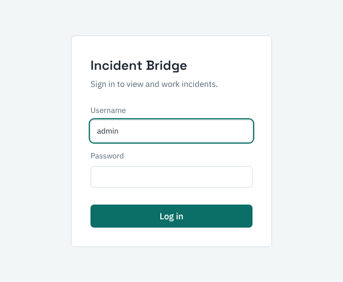](docs/screenshots/01-login.png)

**2. Dashboard** — the text filter (title, description and comments), the other filters, *Check stale incidents*, *New incident* and the admin-only *Import seed data*, above four tabs: **Everything** (the **maintenance queue** — FIFO: one at a time, in arrival order — the **fault queue** — priority order: most severe first, every severity together — and the full incident list), **Maintenance** (only its FIFO queue — it already holds every active task, so there is no second list and no sorting — plus *Pressing maintenance calls*), **Faults** (its queue and active faults) and **Archive** (closed incidents of both kinds). Every open tab updates live ([§5](#5-incident-lifecycle-and-actions), [§11](#11-architecture--as-built)).

[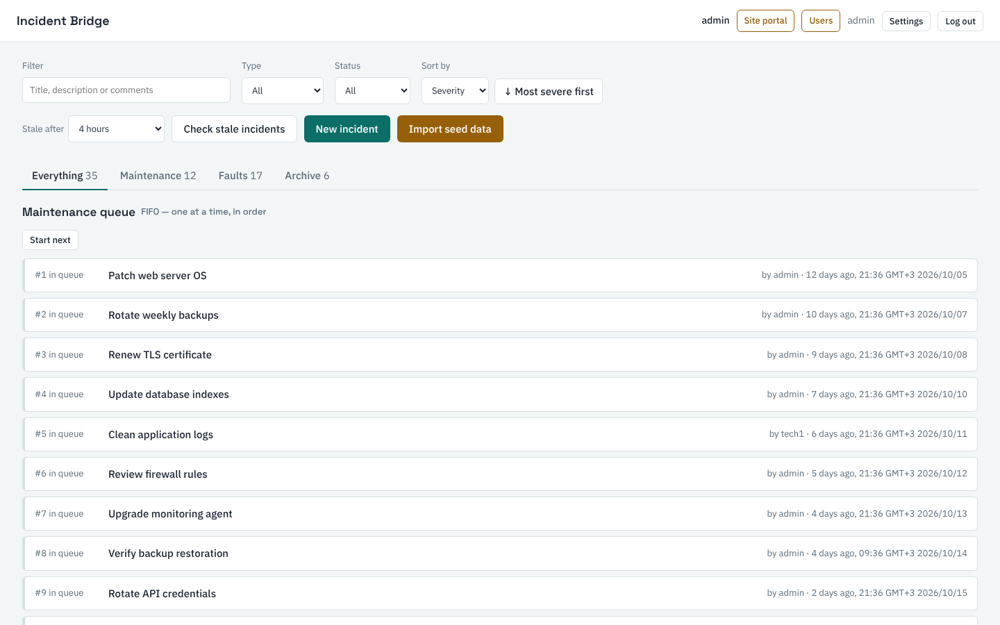](docs/screenshots/02-dashboard.png)

**3. A fault with an AI analysis** — `seed-075`, a fault with an investigation thread by three technicians. The admin pressed *Analyze*: the request comment comes first, then the answer posted by the built-in `ai-assistant` user, with the provider and model in its header. Because nothing has changed since, *Analyze* is greyed out (*No changes since the last analysis*), and the admin's *Re-analyze* counts down the 5-minute cooldown. Captured with the built-in fake provider (`AI_PROVIDER=fake`, no key); with Gemini the header reads *AI analysis by Gemini (model: …)* ([§17](#17-ai-analysis-of-faults-worker-thread)).

[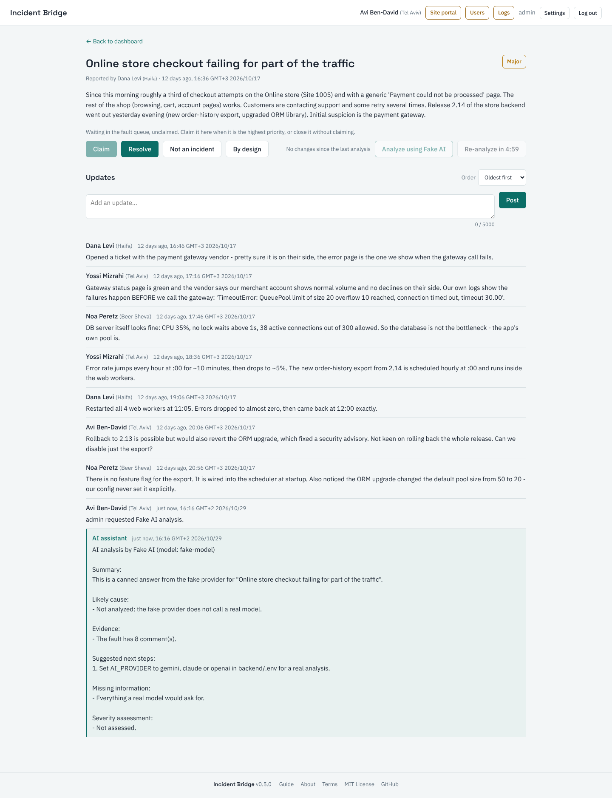](docs/screenshots/03-fault-ai-analysis.png)

**4. Site portal (admin only)** — after *Check all sites*: the four internal sites (`*.invalid` addresses in the sample data) gave no response and are marked *Degraded*, the summary lists sites that look fine but have active incidents mentioning them, a mailing list with no members is flagged, and 3 notifications wait for an admin's decision ([§6](#6-sites--mailing-lists-subsystem-group-of-four-extension)).

[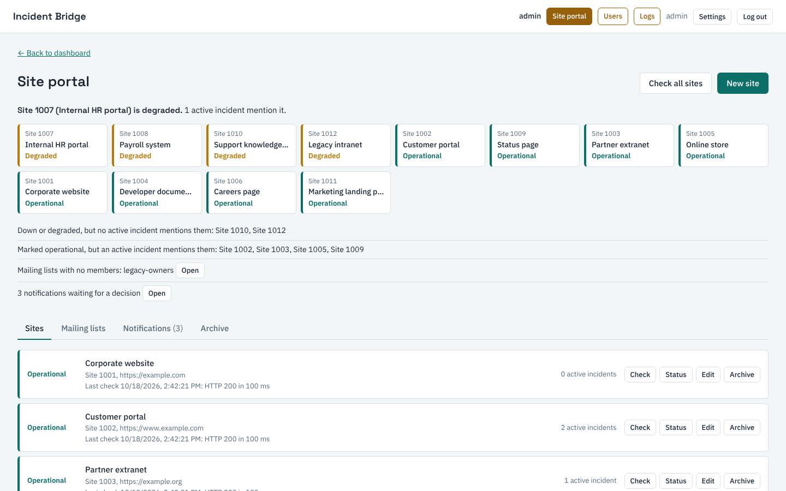](docs/screenshots/04-sites-portal.png)

**5. Pressing maintenance calls** — open maintenance tasks that have waited more than 3 days, oldest first, produced by a generator in a lazy pipeline (*Examined 35 of 35 incidents*); *Show first* stops the pipeline early ([§9](#9-iteration-iterableiterator-generator-and-lazy-pipeline)).

[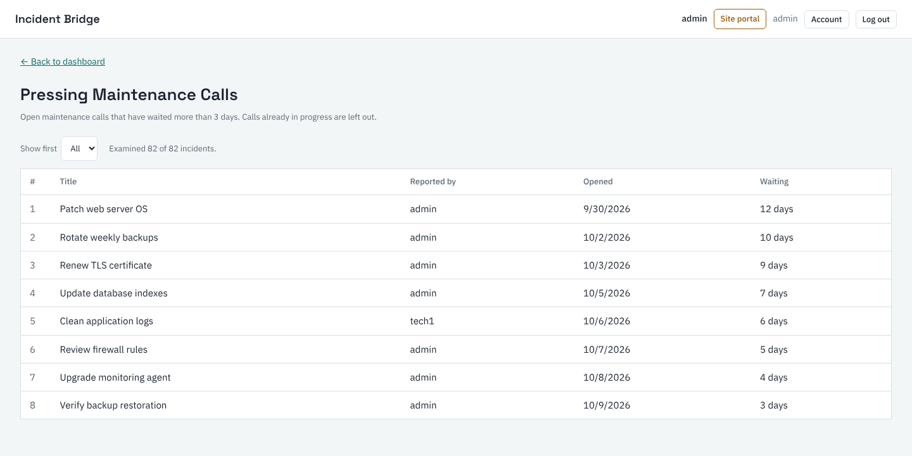](docs/screenshots/05-pressing-calls.png)

**6. Settings — Password** — current password, new password and its confirmation; the **i** button shows the password policy and links to it in the Guide, and the checklist ticks off each rule while typing (*Not a common password* is checked by the server on save).

[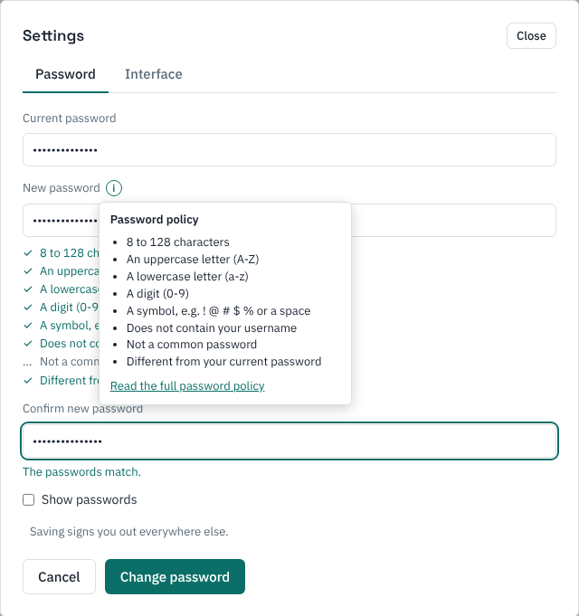](docs/screenshots/06-settings-password.png)

**7. Settings — Interface** — color scheme (System / Light / Dark) and text size, saved with the account and applied to every page.

[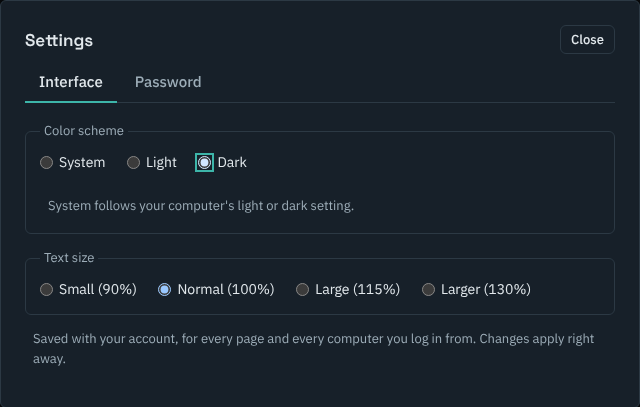](docs/screenshots/07-settings-interface.png)

**8. Dark theme** — the dashboard's *Faults* tab: the fault queue in priority order, with each fault's time as *hours ago, HH:MM zone YYYY/MM/DD* in the viewer's own time zone (captured in Israel time, GMT+3).

[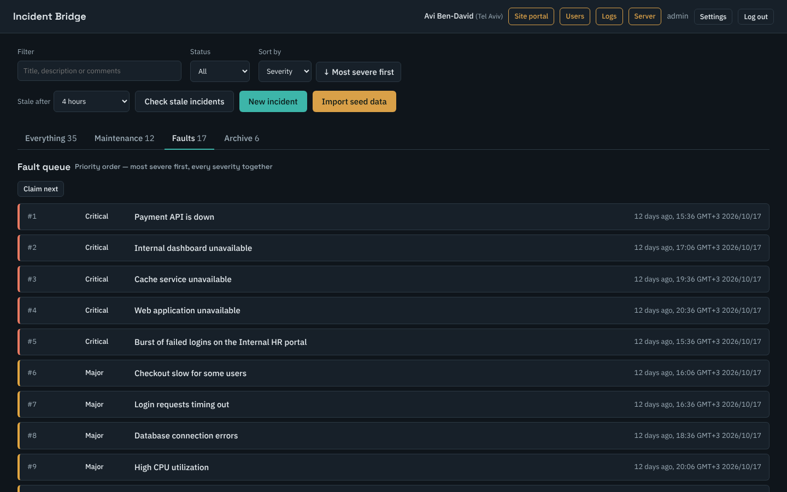](docs/screenshots/08-dashboard-dark.png)

**9. Users (admin only)** — the *Display names* format for everyone (here with the location, shown lighter), then every account by name with its username, role and status; new accounts and reset passwords must be changed at the next login, and an admin cannot change their own role or disable themselves.

[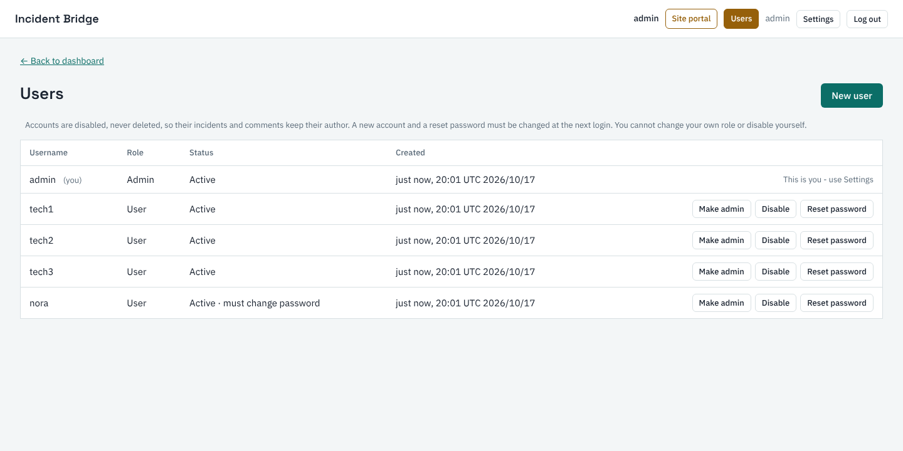](docs/screenshots/09-users.png)

**10. Activity log (admin only)** — every action, request and external call, newest first, filtered here to *All except HTTP requests*; *Check integrity* found every signature valid and the chain complete up to the database checkpoint, and one `incident.claimed` record is open to show all its fields ([§11](#11-architecture--as-built)).

[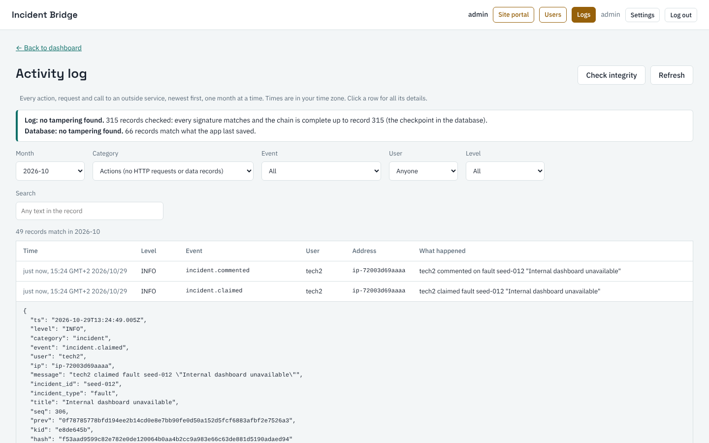](docs/screenshots/10-logs.png)

**11. First-start setup — the recovery key** — a new installation opens this page: after the setup code from the server console, the recovery key is shown once (copy / download) and confirmed by typing its last two groups; then the first admin and the optional AI settings. Captured on a machine without a credential store, hence the note about the key file ([§11](#11-architecture--as-built)).

[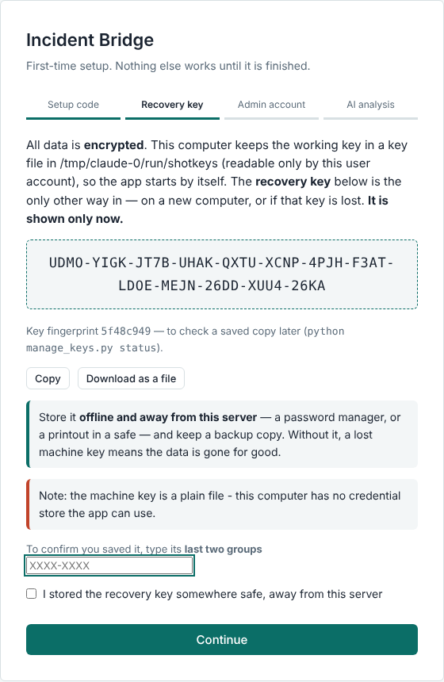](docs/screenshots/11-setup-recovery.png)

**12. A person's details** — name, job title and location, and a display-name format of their own; the line under it shows the result, with the location lighter.

[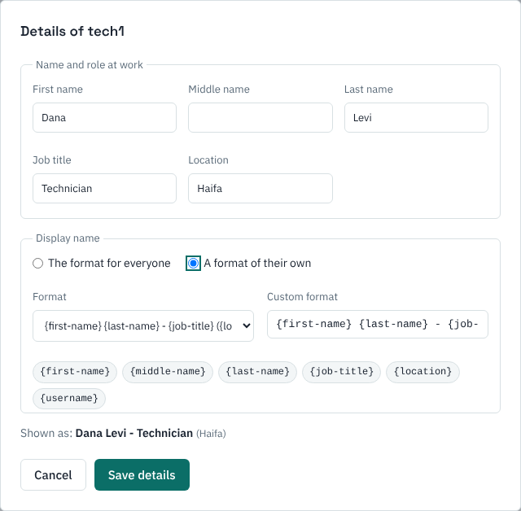](docs/screenshots/12-user-details.png)

The same images illustrate the app's own **Guide** page (`/guide.html`), which serves them from this folder at `/screenshots/` — one copy for both.

*Updating the screenshots:* run the app with a fresh database (`AI_PROVIDER=fake`, `SITES_SEED_PATH` and `MAILING_LISTS_SEED_PATH` set), finish the setup page (capturing its panel at the recovery-key step), import the sample data, press *Check all sites* and analyze `seed-075`, then capture each page in a 1440×900 browser window — the login page cropped to its card (580×477), the pressing page and the Users page to 1440×720, the Logs page (after a failed and a successful login and a claim from another browser, *Check integrity*, one record opened) at 1440×900, the fault page as a full-page capture, the two Settings tabs cropped to the dialog, and the dark dashboard on its *Faults* tab — and save each under the same file name in `docs/screenshots/`. Then update the `width`/`height` of the matching `` in `frontend/guide.html` if a size changed.

---

## Part A – Project Proposal

*This is the business proposal submitted for approval in Stage 1, Part A. It contains no code or technical design and is unchanged since approval; the group-of-four extension built afterwards is described in [§6](#6-sites--mailing-lists-subsystem-group-of-four-extension).*

**Project name:** Incident Bridge
**One-sentence description:** An internal system for logging, prioritizing, and tracking routine maintenance tasks and operational faults across an organization's IT environment.

**Business need:** Teams currently lack a structured way to (a) ensure routine maintenance steps happen in the correct order without being skipped, and (b) make sure the most severe faults get attention first instead of being handled in arrival order. This leads to missed maintenance steps and delayed response to critical outages.

**Key users and roles:**
- **Admin** — IT manager / team lead. Full visibility over all incidents, can manage users, reclassify severity, and close incidents (including as "not an incident" or "by design").
- **User** — technician / support agent. Reports incidents, works assigned incidents, updates status, and adds comments.

**Main business process:** An incident is reported and classified as either *maintenance* or *fault/issue*. Maintenance tasks are placed into a strict first-in-first-out queue — a task cannot start before the previous one is completed, and the order can never be changed. Faults of every severity — Critical, Major, and Minor alike — are scored and placed into a single shared priority queue, so the most severe fault is always handled first regardless of when it arrived. Assigned staff update the incident's status and add comments until it is closed with a documented reason.

**Information flow:** Incoming — incident title, description, source system, and relevant details. Created/updated by — the reporting user, the assigned technician, and admins. Produced — a prioritized worklist per incident type, a full comment/update history per incident, and a documented closure reason.

**Business value:** Faster response to critical failures, no skipped or reordered maintenance steps, a clear audit trail of who did what and when (including *why* an incident was closed), reduced downtime, and improved user experience for the organization's internal customers.

**Core entities and relationships (high level):**
- A **User** creates and/or is assigned to **Incidents**.
- An **Incident** is either a **Maintenance Task** or a **Fault**.
- A **Fault** has exactly one **Severity Category** (Critical / Major / Minor), and every fault — regardless of category — goes through the same priority queue.
- An **Incident** has many **Comments**, each written by a **User**, and a mandatory closure message once resolved.

**Two main usage scenarios:**
1. A production system becomes unavailable. It is scored as *Critical*, jumps to the top of the shared fault priority queue ahead of any Major/Minor faults, and the on-call engineer is alerted, resolves it, and documents the steps taken via comments and a closing message.
2. A weekly batch of scheduled server maintenance tasks is queued in sequence. Each task must be marked complete before the next one can start, in strict, unchangeable order — not even an Admin can reorder or skip a task.

**Future expansion idea:** Connect the system to an external monitoring/alerting service so that real-time alerts automatically generate fault incidents instead of requiring manual entry.

---

## 1. Business process

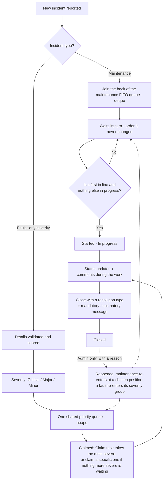

Key rules:
- **Maintenance = order matters, severity doesn't, order is immutable.** Only the first task in line can start, and only when nothing is in progress.
- **Faults = severity matters, arrival order is only the tiebreaker, all severities share one queue.**
- **Every closure — whatever the reason — requires a written explanation**, and every status change is logged as a comment saying who did it and why.
- A pending maintenance task may **leave from any position, but only by being closed with a reason** — the tasks behind it move up; nothing is reordered.
- A closed incident can be **reopened by an admin only**, with a reason (details in [§5](#5-incident-lifecycle-and-actions)).

## 2. Severity scoring

Severity is decided by a dedicated component, `SeverityScorer` (`backend/app/services/severity_scoring.py`), not inside the `Fault` class, so the rules can later be replaced (e.g. by an external rules engine) without touching the domain model or the queue.

- **Input:** a `details` object, every field optional: `system_unavailable`, `security_breach`, `performance_degraded` (true/false) and `affected_users_percent` (0–100) — the four questions on the *New incident → Fault* form. A fifth flag, `cosmetic_only`, is also accepted (the sample data uses it to describe purely visual faults) but does not change the result, because anything that is not Critical or Major is already Minor; that is why the form does not ask for it.
- **Rules:** system unavailable or a security breach → **Critical**; performance degraded or at least 25% of users affected → **Major**; anything else → **Minor**.
- **Validation:** `SeverityScorer.validate_details()` runs first on every path (API and file import): `details` must be an object, only the known fields are allowed (a typo would otherwise silently lower the severity), flags must be true/false and the percentage a number from 0 to 100. Invalid details are an HTTP 400 in the API and a skipped record in an import — never a crash.
- **Categories are fixed** (no others exist) and all three go into the same priority queue: Critical = 1, Major = 2, Minor = 3 — a lower number means more urgent.
- An admin can change a fault's severity afterwards; the fault then moves to its new place in the queue.

## 3. Data structures — what is used where, and why

| Need | Structure | Why it fits | Where |
|---|---|---|---|
| Maintenance tasks handled strictly in arrival order | `collections.deque` | O(1) append at the back and pop from the front — exactly FIFO, and the class exposes no way to reorder it | `MaintenanceQueue` (`app/queues/maintenance_queue.py`) |
| The most severe fault first, ties by arrival | `heapq` over a list of `(severity, counter, fault)` tuples | O(log n) push/pop of the minimum; the tuple sorts by severity first, then by a rising arrival counter | `FaultPriorityQueue` (`app/queues/fault_queue.py`) |
| Find an incident, user, site, list or notification by id | `dict` | O(1) lookup by key; `.get()` where a missing key is a normal case (e.g. an unknown username) | `IncidentRepository`, `UserStore` (`app/repository.py`), `SiteDirectory` (`app/sites.py`) |
| A list's members and related sites; admin-only resolutions; active statuses; sites being checked right now | `set` | No duplicates, O(1) membership tests, and set algebra (union, difference, intersection) for the report | `MailingList`, `Incident`, `site_scan.py`, `SiteCheckSession`, `reports.py` |
| Short fixed records: a status-history entry, one availability check, a scan match, a heap entry | `tuple` / `NamedTuple` | Immutable and lightweight — a record that must not change after it is created | `SiteStatusChange`, `AvailabilityCheck` (`app/models/site.py`), `SiteMention` (`app/site_scan.py`) |
| An incident's comment thread; report rows | `list` | Ordered and appendable | `Incident.comments`, `SiteReport.rows` |
| Grouping and counting (comments per incident, lists per site, statuses per count) | `dict` of lists / counts | One pass groups or counts everything | `persistence.py`, `reports.py` (`count_by`) |

**Why the order matters for maintenance:** maintenance steps depend on each other (patch, then reboot, then verify), and arrival order is also fairness — a task added later must never overtake one that has been waiting. With an empty queue, "start next" raises `IndexError`, which the API turns into HTTP 404 and the demo catches and reports.

**Smaller number = higher priority** for faults: Critical (1) sorts before Major (2) and Minor (3). The heap's internal list is *not* sorted — only its first item is guaranteed to be the smallest — so displaying the whole queue in priority order walks a sorted copy ([§9](#9-iteration-iterableiterator-generator-and-lazy-pipeline)).

## 4. The OOP model

### 4.1 Incidents, users and queues

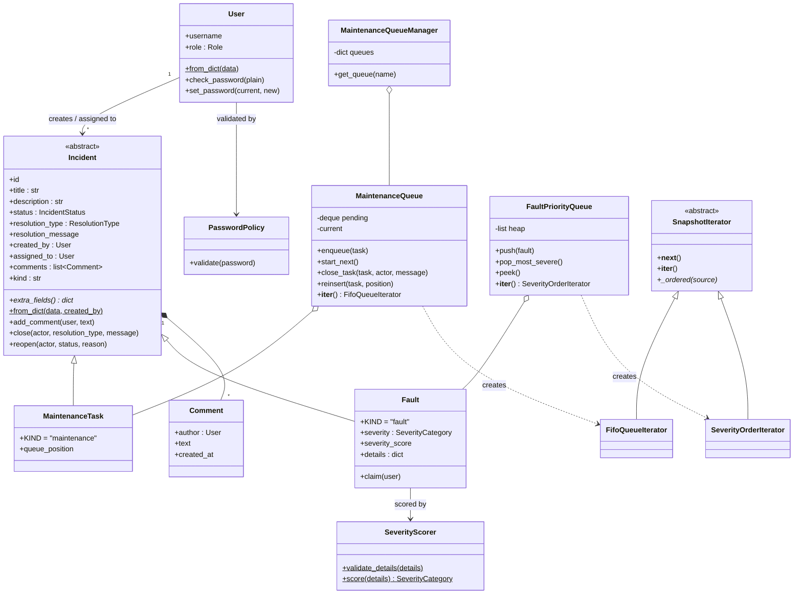

In the diagram, *italic* members are abstract (`extra_fields()`; `kind` is an abstract property implemented by each subclass as its `KIND`), underlined members are class/static methods, `title` and `description` are validated properties, and `MaintenanceQueue`/`FaultPriorityQueue` create a new iterator on every `__iter__` call. The Sites & Mailing Lists classes are shown in [§6](#6-sites--mailing-lists-subsystem-group-of-four-extension).

### 4.2 How the brief's OOP requirements are met

- **Classes with real responsibility:** `User`, `Comment`, `Incident`/`MaintenanceTask`/`Fault`, the two queues and their manager, `PasswordPolicy`, `SeverityScorer`, plus the subsystem's `Site`, `MailingList`, `Notification` and `SiteDirectory`.
- **Alternative constructors (`@classmethod`):** `MaintenanceTask.from_dict` / `Fault.from_dict` (one JSONL record), `User.from_dict` (one entry of `INCIDENT_BRIDGE_USERS`), `Site.from_dict`, `MailingList.from_dict`, `Notification.draft_for`, `HttpChecker.from_env`, and the `from_persisted` constructors used when reloading from the database.
- **`__str__` and `__repr__`:** every domain class, queue, store and iterator has both — `__str__` is a readable summary, `__repr__` shows the state useful when debugging (ids, counts), never secrets.
- **Composition:** an `Incident` holds its `Comment`s (both the updates people write and the automatic status-change log entries — see [§5](#5-incident-lifecycle-and-actions)); `MaintenanceQueue` holds tasks (enqueue, start, close from any position, reinsert, membership, length); `FaultPriorityQueue` holds faults (push, pop, remove, reprioritize, count of more-severe faults); a `MailingList` holds its members and site ids; a `Site` holds its status history; `SiteDirectory` holds sites, lists and notifications.
- **Inheritance and overriding:** `MaintenanceTask` and `Fault` inherit the whole lifecycle from `Incident` and override `__str__`, `from_dict`, `kind` and `extra_fields`; `Fault` also overrides `reopen`. The same pattern is used for `AvailabilityChecker` → `HttpChecker` / `FakeChecker`, `Notifier` → `OutboxNotifier`, and `SnapshotIterator` → `FifoQueueIterator` / `SeverityOrderIterator`.
- **Polymorphism instead of type checks:** code that handles incidents never asks which class an object is to decide what to do. The serializer, persistence, live-update events, list filtering and queue restoring all use `incident.kind` and `incident.extra_fields()`; even the seed import picks the right queue with a lookup by `kind`. A test adds a made-up third incident type and shows it serializes with no change to the serializer (Open/Closed). The remaining `isinstance` checks in `app/api/incidents.py` only validate input ("this id is not a fault" → 404).
- **Abstract classes / interfaces:** `Incident` (abstract `kind` and `extra_fields()`), `AvailabilityChecker` (abstract `check()`), `Notifier` (abstract `deliver()`) and `SnapshotIterator` (abstract `_ordered()`). Python itself refuses to create them, or a subclass missing one of the members.
- **Validation (`ValueError`, never an invalid object):** `Incident.title` / `description` (non-blank, max 200 / 10,000 characters), `Site.site_name` / `site_url` (http/https only) / `site_publish_date` (not in the future), `MailingList.name`, `Notification.message`, passwords (`PasswordPolicy`) and fault details (`SeverityScorer`). They are property setters, so an invalid edit leaves the old value in place.
- **Extra tools:** `@classmethod`, `@staticmethod`, computed `@property`s (e.g. `MaintenanceQueue.current_task`, `Site.label`), `__len__`, `__contains__`, and `__eq__`/`__hash__` on `Site` (equal by id, usable in sets).

## 5. Incident lifecycle and actions

| Status | Meaning | Reached by |
|---|---|---|
| Open | Reported, waiting | Creation, or an admin reopening a closed incident |
| In progress | Being worked on | Starting the first maintenance task in line, claiming a fault, or an admin reopening into this status |
| Closed | Finished, with a resolution type and a mandatory message | `close()` |

**Resolution types** — all three are the same closing action with a different recorded reason, and all three require a message:

| Resolution type | Meaning | Who can set it |
|---|---|---|
| Resolved | The incident was fixed | Any logged-in user |
| Not an Incident | Determined to be a non-issue | Admin only |
| By Design | The behavior is intentional | Admin only |

**Actions:**
- **Maintenance:** *Start next* (dashboard) or *Start* on the task's own page — only for the first task in line, and only while nothing is in progress. *Complete*/*Close* the in-progress task, or close a pending task from any position (with a reason).
- **Faults:** *Claim next* takes the most severe fault waiting. *Claim* on a fault's own page is allowed for any fault in the top severity group — if more severe faults are still waiting, the button is disabled and shows how many. Claiming makes it In progress and assigns it to the claimer.
- **Change severity** (faults) — admin only; the fault moves to its new place in the queue.
- **Reopen** a closed incident — admin only, reason required, previous resolution kept in the log. A maintenance task chooses its new position in the queue (Open), or position 1 if reopened as In progress and nothing else is in progress. A fault reopened as Open re-enters the queue at the back of its severity group; as In progress it is assigned to the admin.
- **Comments/updates** — any logged-in user, also on closed incidents. The incident page can show them oldest-first or newest-first (remembered per browser). A comment may be at most **5,000 characters**, and a closing message or reopen reason at most **1,000** (it is embedded in a log comment, so it must leave room for the rest of that comment); the backend enforces both (`MAX_COMMENT_LENGTH` in `app/models/comment.py`, `MAX_REASON_LENGTH` in `app/models/incident.py`), and the incident page shows a live character counter under each text box (`frontend/js/text-limits.js`).
- **Analyze using <provider>** (open and in-progress faults, any logged-in user) — queues an AI analysis of the fault; the answer arrives as comments by the built-in `ai-assistant` user. See [§17](#17-ai-analysis-of-faults-worker-thread).
- **Every status change is logged** in the incident's comment thread, authored by whoever made the change. So the thread holds two kinds of entries: updates people write, and automatic log entries such as:
  - `Status changed from Open to In progress. Assigned to tech1.` (a fault claimed)
  - `Status changed from In progress to Closed. Reason: works as intended. Resolution: By design.` (a close — the closing message is the reason)
  - `Status changed from Closed to Open. Reason: Regression found. Previous resolution: Resolved - Fixed it. Queue position: 3.` (an admin reopen — the earlier resolution is kept)
  - `Work session completed after 42.0s.` / `Work session interrupted after 3.1s by RuntimeError: disk full` (`IncidentWorkSession`, [§10](#10-context-managers))

  Part A's "a mandatory closure message once resolved" is exactly this: the closing message is stored on the incident and also recorded as the reason in the log entry.
- **Dashboard tabs:** *Everything*, *Maintenance* (just the FIFO queue: it already holds every active task, in order, so it has no second list, no status filter and no sorting), *Faults* (the priority queue, plus the list of open and in-progress faults — claimed faults leave the queue) and *Archive* (closed incidents, most recently closed first; a reopened incident moves back automatically). On *Everything* and *Faults* the list sorts by severity, status or report time, with a button that reverses the order (*Most severe first* / *Least severe first*, *Open first* / *Closed first*, *Newest first* / *Oldest first*; maintenance tasks, which have no severity, stay last when sorting by severity). Each tab shows its count; the open tab is kept in the URL (`dashboard.html#faults`) and, with the filter text, for the browser tab's session, so coming back from an incident page restores both.
- **Text filter:** filters every list and queue of the open tab by title, description **and comments** (case-insensitive; with several words, each must appear). Queue rows keep their real position; a row matched only by a comment says *match in comments*; the tab counts show *matching / total*. It runs in the browser on the data the page already loads — no extra server call.
- **Dashboard helpers:** *Pressing maintenance calls* (Maintenance tab; open tasks waiting more than 3 days, [§9](#9-iteration-iterableiterator-generator-and-lazy-pipeline)) and *Check stale incidents* (every tab except Archive; in-progress incidents with no update for a chosen time, default 4 hours, highlighted in the lists).

## 6. Sites & Mailing Lists subsystem (group-of-four extension)

An admin-only portal that monitors the organization's websites, notifies the right people when one has a problem, and connects sites to the incidents that mention them. It is opened with the **Site portal** button next to the admin's username in the top bar.

### 6.1 Entities

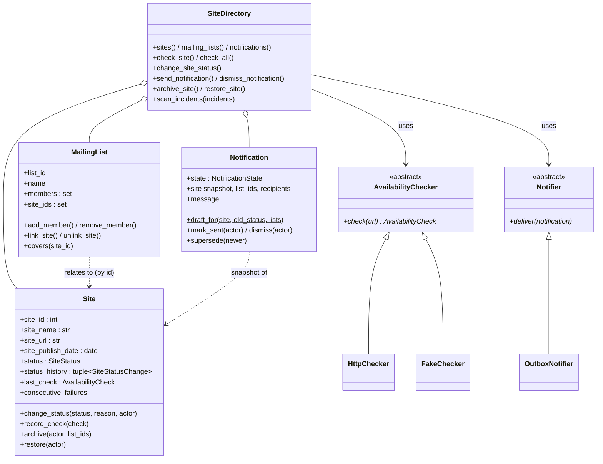

- **`Site`** — `site_id` (never reused), `site_name`, `site_url` (http/https only), optional `site_publish_date` (not in the future), plus its status, status history and latest check result.
- **`MailingList`** — a named set of member email addresses and the ids of the sites it should be notified about (many-to-many, stored on the list side only).
- **`Notification`** — a snapshot of one status change addressed to the covering lists, with its own lifecycle.
- **`SiteDirectory`** (`backend/app/sites.py`) — the collection: lookup by id, duplicate and cross-reference rules, archive/restore cascades, checks, the notification process and saving.

### 6.2 Processes and states

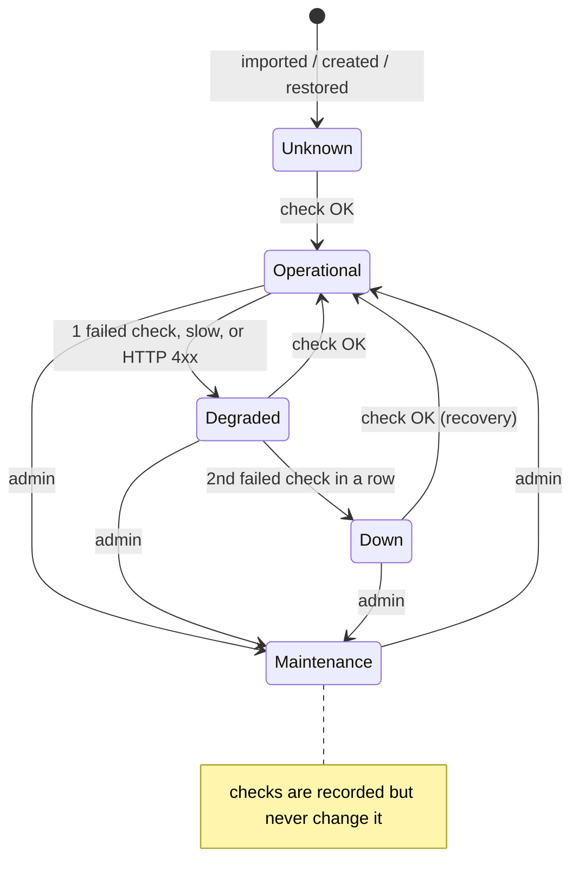

- **Availability check** (`backend/app/services/availability.py`): one HTTP GET with a timeout. 2xx/3xx in time → Operational; slower than the threshold, or 4xx → Degraded; 5xx, timeout or no connection → a failure. One failure makes the site Degraded, **two in a row** make it Down, so one dropped request never raises an outage. An admin can also set any status by hand, with a reason; Maintenance is manual only.
- **Notifications:** every worthwhile status change creates a notification to the **active** mailing lists covering the site — a **Draft**, or **Skipped** when nobody would receive it. "Worthwhile" excludes Unknown → Operational (a new site found healthy) and any change to Unknown (a restore). A newer draft for the same site **supersedes** an older unsent one. An admin reviews a draft, may edit the text, and **sends** it (through the `Notifier` interface; delivery is recorded in an in-app outbox, no real email) or **dismisses** it. A failed delivery leaves it a Draft to retry. **Archive:** a sent, dismissed or skipped notification moves from the *Notifications* tab to the *Archive* tab, view only, `NOTIFICATION_ARCHIVE_DAYS` days after it was finished (default 30; `0` = never). It is worked out from the notification's own times (`Notification.is_archived()`), so nothing extra is stored; Drafts are never archived, and only a Draft can be edited, sent or dismissed. `GET /sites/notifications?archived=true` lists the archived ones.

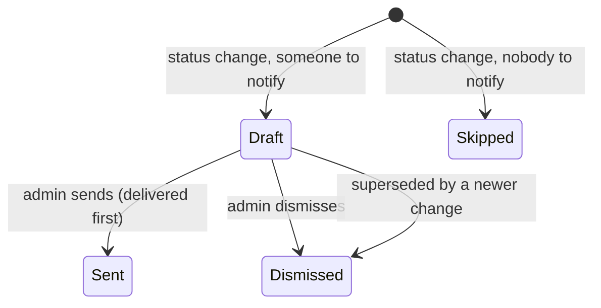

- **Archive and restore:** "deleting" a site or list archives it. Archiving a site unlinks it from every list (remembered); restoring re-links it and resets its status to Unknown. Ids are never reused, so old incident text always points at the right site.

### 6.3 Link to the core model: which incidents mention a site

`backend/app/site_scan.py` scans every **Open or In-progress** incident's title, description and comments. An incident counts for a site when it contains:

- the id after the word "site", in any letter case: `Site 1007`, `Site #1007`, `Site-1007` (also `site 1007`, `Site - 1007`) — but not `Website 1007`, `Sites 1007`, `Site1007` or `Site: 1007`, and `Site 10070` is site 10070, never 1007;
- or the site's **full** name, in any letter case: `Internal HR portal is down`, ``Error loading `Internal HR portal` `` — a partial name (`HR portal`) does not count, and where two names overlap the longest wins.

Each incident counts once per site. The scan is a lazy generator pipeline ([§9](#9-iteration-iterableiterator-generator-and-lazy-pipeline)); its results appear on the portal's site rows, the status board, each site's details and the report.

### 6.4 Cross-reference validation and the report

- **Validation:** a mailing list referring to a site that does not exist or is archived — in the seed file or in an edit — is rejected (edit) or loses that link with a warning (seed import). An incident mentioning a site id that does not exist is listed as an **unknown site reference**; one mentioning an archived site, as an **archived site reference**.
- **Site health report** (`backend/app/reports.py`), shown at the top of the portal and at `GET /sites/report`: the most urgent site, every active site ordered Down → Degraded → Unknown → Maintenance → Operational, then by number of incidents; **outages no incident mentions**; sites still Operational although incidents mention them; sites no list covers; lists with no sites or no members; unknown/archived references; status and notification counts.

### 6.5 Access, live updates and storage

- **Admin only, everywhere:** the button is shown to admins only, a non-admin opening `/sites.html` is sent back to the dashboard, every `/sites` endpoint returns 403 for non-admins, and the domain layer checks the admin rule again on every change.
- **Live updates** go to **admin tabs only** (events are published with a role audience) and carry `scope: "sites"`, so only the portal reacts to them; the incident pages are unaffected.
- **Storage:** sites (with history and last check), lists (with members and links) and notifications are saved in the same SQLite file as incidents, through a separate store (`backend/app/persistence_sites.py`). New columns are added automatically to older database files.
- **Seed import is opt-in:** `data/sites.jsonl` and `data/mailing_lists.jsonl` are imported at startup only when `SITES_SEED_PATH` / `MAILING_LISTS_SEED_PATH` are set. Ids already stored are skipped, so in-app edits are never overwritten and archived sites never come back.

### 6.6 How it meets the group-of-four requirements

| Requirement | How |
|---|---|
| At least 2 new entities | `Site`, `MailingList`, `Notification` (and `AvailabilityCheck`) |
| At least 3 business operations | Create / edit / archive / restore sites and lists, link sites to lists, check sites, change status, send / dismiss notifications, scan incidents |
| A process with a start, states and a result | The site status lifecycle and the notification lifecycle above |
| A real link to the core model | The incident scan: incidents mention sites by id or full name |
| An extra data file related to the main one | `data/sites.jsonl` and `data/mailing_lists.jsonl`; incidents in `data/sample_data.jsonl` mention those sites |
| Cross-reference validation | Unknown/archived site ids in mailing lists and in incident text |
| A report / decision-support tool | The site health report |

## 7. Data files: source, structure, loading and validation

All three data files were **generated with AI tools** (see `AI_USAGE.md`), then checked and corrected: every record must pass the same validation the app applies, and a test checks that the bundled files load with no errors.

| File | Records | One record looks like |
|---|---|---|
| `data/sample_data.jsonl` | 35 incidents: 15 maintenance tasks and 20 faults (5 critical, 6 major, 9 minor); 6 of them (3 of each kind) are already closed, for the dashboard's Archive tab; several mention sites; `seed-075`–`seed-082` are complex faults with an investigation thread, for AI analysis; the first ten maintenance tasks are 1–12 days old (`created_at`), so *Pressing maintenance calls* and *Check stale incidents* have something to show. Ids keep their original numbers (gaps are expected) | `{"id": "seed-003", "kind": "fault", "title": "Payment API is down", "description": "...", "created_by": "tech1", "details": {"system_unavailable": true}}` — optional `assigned_to`; `details` for faults only; optional `created_at`, `comments` and `closed` (below) |
| `data/sites.jsonl` | 12 sites | `{"site_id": 1007, "site_name": "Internal HR portal", "site_url": "https://hr.incident-bridge.invalid", "site_publish_date": "2020-07-14"}` |
| `data/mailing_lists.jsonl` | 6 mailing lists | `{"list_id": "hr-systems", "name": "HR systems owners", "members": ["hr.it@example.com"], "site_ids": [1006, 1007, 1008]}` |

**Optional timeline fields** (`IncidentRepository._apply_seed_timeline`), so a sample incident can look like one that has been worked on for a while:

```json
{"id": "seed-075", "kind": "fault", "...": "...", "created_at": "2026-10-16T09:00:00Z",
 "comments": [{"author": "tech1", "text": "Opened a ticket with the vendor.", "created_at": "2026-10-16T09:10:00+00:00"},
              {"author": "tech2", "text": "Vendor says it is not on their side."}]}
```

- **Times:** `created_at` is an ISO 8601 date and time **with a time zone** (`Z` or `+03:00`), not in the future. So an incident imported today can be dated yesterday. The older relative form `"minutes_ago": 1440` (counted back from the moment of the import) still works; giving both is an error. The bundled sample data uses `created_at` throughout.
- `created_at` on the record: when it was reported. Without it, the report time is the import time — or the oldest comment's time, so a report is never newer than its own updates.
- `comments`: the update thread, **oldest first**. Each needs a known `author` (same rule as `created_by`) and a non-blank `text` within the 5,000-character comment limit; `created_at` is optional (default: the import time).

**Optional `closed` block** (`IncidentRepository._apply_seed_closure`), for incidents that are already finished:

```json
{"id": "seed-005", "kind": "fault", "...": "...", "created_at": "2026-10-15T08:00:00Z",
 "closed": {"by": "tech3", "resolution": "resolved", "message": "Typo fixed in the invoice template.", "closed_at": "2026-10-16T08:00:00Z"}}
```

- `by` (a known user), `resolution` (`resolved`, `not_an_incident` or `by_design`) and `message` follow the normal close rules (`Incident.close()`: message required; *Not an incident* and *By design* are admin-only); `closed_at` (optional, default: the import time; same format as `created_at`, or `minutes_ago`) may not be older than the incident or its newest comment.
- The closing log comment gets that time. A closed record goes into **no queue** — the import endpoint only queues records that are still Open.

Addresses ending in `.invalid` are a reserved domain that never resolves, so those sites reliably show as Down in a check; email addresses are synthetic (`@example.com`).

**How a file is loaded** (`IncidentRepository.load_from_jsonl` in `app/repository.py`, `SiteDirectory.load_sites_from_jsonl` / `load_mailing_lists_from_jsonl` in `app/sites.py`):

1. `with open(path, encoding="utf-8")`, reading **line by line** (never `read()` or `readlines()`).
2. Each line → `json.loads` → a `dict`.
3. The dict → an object through the class's `from_dict` alternative constructor, which validates every field.
4. The object is added to the collection; the result reports what was created and what was skipped, with reasons.

**Validation decisions** — a bad record is **skipped and reported, never a crash**, and the rest of the file still loads:
- a missing or invalid `id` → rejected (ids make re-importing idempotent);
- an id already loaded → skipped, never overwritten; the same id twice in one file → reported as a duplicate;
- unknown `kind`, blank or over-long title/description, invalid `details`, an unknown `created_by`/`assigned_to` user, a line that is not a JSON object, broken JSON → skipped with the reason;
- an invalid time (`created_at`/`closed_at` without a time zone or in the future, a negative `minutes_ago`, or both forms at once), or a `comments` entry with an unknown author, an empty or too-long text, comments out of order, or a comment older than its incident → the whole record is skipped with the reason;
- a mailing list linking an unknown or archived site → the link is dropped with a warning, the list still loads.

**Ways to load the data:** `python main.py` (offline demo, in memory); the admin's **Import seed data** button on the dashboard; `backend/seed_from_jsonl.py` (imports into a **running** server over its API, so the new incidents appear live); and the opt-in startup import for sites and lists ([§6.5](#65-access-live-updates-and-storage)).

## 8. Collection operations: changing a collection vs. creating a new one

| Operation | Changes the existing collection | Creates a new collection | Where |
|---|---|---|---|
| `deque.append` / `deque.popleft` | ✔ | | `MaintenanceQueue.enqueue` / `start_next` |
| Removing a pending task from the middle | | ✔ (a new `deque` without it replaces the old one) | `MaintenanceQueue.close_task` |
| `heapq.heappush` / `heappop`, re-heapify after a removal | ✔ | | `FaultPriorityQueue` |
| `sorted(heap)` for display / iteration | | ✔ (a sorted copy; the heap is untouched) | `SeverityOrderIterator`, `iter_by_severity` |
| `list.append` of a comment or history entry | ✔ | | `Incident.add_comment`, `Site` status history |
| `status_history`, `members`, `site_ids` getters | | ✔ (a tuple / sorted tuple — callers cannot edit the original) | `Site`, `MailingList` |
| `set.add`, `set.discard`, `set.remove` | ✔ | | `MailingList`, `SiteCheckSession` |
| `|`, `&`, `-` on sets | | ✔ | `reports.py` (uncovered sites, unreported outages, …) |
| `dict[key] = …`, `dict.setdefault(...).append(...)` | ✔ | | repositories, grouping in `persistence.py` / `reports.py` |
| List / dict / set comprehensions | | ✔ | `reports.py`, `api/serializers.py`, `main.py` |
| Generator expressions | | ✘ neither — a lazy iterator, nothing is stored | `site_scan.py`, `iterators.py` |

## 9. Iteration: Iterable/Iterator, generator and lazy pipeline

All of this lives in `backend/app/iterators.py`, except the scan pipeline in `app/site_scan.py`.

**Iterable and Iterator.** The two queues are the *Iterables*: they own the data and implement `__iter__`. Every `iter(queue)` returns a **new** *Iterator* object — `FifoQueueIterator` (pending maintenance tasks in arrival order) or `SeverityOrderIterator` (faults most severe first, ties by arrival). The iterator holds only its own **snapshot** of the items and its **position**; `__next__` returns the next item or raises `StopIteration` (and keeps raising it), and `__iter__` returns the iterator itself. Because each iterator has its own snapshot and position:
- two iterators over the same queue advance **independently**;
- adding or closing a task during iteration is safe (a plain `deque` would raise "mutated during iteration");
- iterating never changes the queue.

**Generator with `yield`** — `stale_in_progress_work()`: yields, one at a time, only incidents that are **In progress** and have had **no update for more than a threshold** (default 4 hours) — work that may be stuck. Calling it creates a generator and reads nothing; `next()` returns one result and pauses there; a following `for` loop **resumes from that point**; once finished it is **exhausted** and yields nothing more — a new call is needed to go through the data again. Used by `GET /incidents/work/stale` and the dashboard's *Check stale incidents* button.

**Lazy pipeline** — `pressing_maintenance_calls()`: three chained generator expressions over all incidents —
1. keep open maintenance tasks;
2. keep those open more than 3 days, as a short tuple;
3. turn each into a small result record with a summary.

Nothing runs until a result is requested. `first_pressing_calls(..., limit=2)` takes only the first two results and stops; a counter shows how many incidents were actually examined, so you can see that the rest were **never touched**. Used by `GET /incidents/maintenance/pressing` and the *Pressing maintenance calls* page (which can show the first 2, 5, 10 or all).

**Incident scan pipeline** (`app/site_scan.py`): active incidents → each text field → every site mention — also lazy, with a test proving only the incidents needed are read.

## 10. Context managers

Both live in `backend/app/context.py`; neither ever suppresses an exception (`__exit__` returns `False`).

- **`IncidentWorkSession`** — brackets a period of work on an incident. On entry it moves an Open incident to In progress and records the start time. On a normal exit it adds a comment with how long the session took; **if the block raises**, it adds a comment saying the session was interrupted and by what, and the exception still propagates — so the audit trail is always accurate.
- **`SiteCheckSession`** — wraps every availability check of a site. On entry it **locks** that site (a second check of the same site at the same moment is refused with a clear error — possible because requests run in parallel threads) and starts a timer. On exit — normal **or by exception** — it always releases the lock and records the duration, so a failed check can never leave a site locked. Used by `SiteDirectory.check_site()`.

## 11. Architecture — as built

- **Backend:** FastAPI (`backend/app/api/app.py`) served by Uvicorn; request bodies are Pydantic models; domain errors map to HTTP codes in one place (`ValueError` → 400, `PermissionError` → 403, `KeyError`/`IndexError` → 404, `RuntimeError` → 409). Interactive API documentation is served by the app itself at **`/docs`** (generated by FastAPI from the code) — this is the API reference; this README is the project documentation.
- **Users and auth:** no self-registration. Accounts live in the database (`users` table, `app/persistence_users.py`). The **first admin** is created on the setup page (below), so no admin password ever sits in a file. **Regular users** can be listed in `INCIDENT_BRIDGE_USERS`; the setup page creates them — validated **fail-fast** (invalid JSON, an invalid entry, an admin entry, a password that breaks the policy, a duplicate username (case-insensitive) or a reserved name is reported with every problem listed) — and they must change their password at first login (`REQUIRE_PASSWORD_CHANGE_ON_FIRST_LOGIN`). **After that the table is the source of truth** and `INCIDENT_BRIDGE_USERS` is not read again: admins manage accounts on the **Users** page (create, change role, disable/enable, reset password — `app/api/users.py`), and `backend/manage_users.py` resets a password from the command line when no admin can log in. Accounts are disabled, never deleted. The name `ai-assistant` is reserved for a built-in **system user** (`app/models/system_users.py`) that the app always adds in memory; it authors AI analysis comments and can never log in.
- **Passwords:** the character-mix policy in `PasswordPolicy` — 8–128 characters with an uppercase letter, a lowercase letter, a digit and a symbol, not containing the username, not on a list of common passwords, and (when changing) different from the current one; served as data by `GET /auth/password-policy` for the live checklist and tooltip, and described on the Guide page (`/guide.html#password-policy`). Stored as PBKDF2-HMAC-SHA256 with a random salt and **600,000 iterations** (the count is stored with each hash; an older, weaker hash is re-hashed at the next login), compared in constant time. Changing a password needs the current one and a matching confirmation (checked by the server).
- **Sessions and login hardening:** a signed cookie holding the username and the user's *session version*; the user, role and version are checked on every request, never trusted from the browser. A password change/reset or disabling the account bumps the version, which ends every other session. The cookie lasts `SESSION_MAX_AGE_HOURS` (default 12) and is `Secure` when `SESSION_COOKIE_SECURE=true`. Failed logins are limited (`app/services/login_guard.py`): 5 per username or 20 per address in 15 minutes lock that username/address for 15 minutes (HTTP 429). An unknown or disabled username gets the same answer in the same time as a wrong password. A user who must change their password gets 403 from every endpoint except `/auth/me` and `/auth/change-password` until they do.
- **Security headers** on every response (`app/api/security.py`): a Content-Security-Policy (scripts, styles, images and API calls only from the app itself, Google Fonts for the two web fonts, no framing), `X-Frame-Options: DENY`, `X-Content-Type-Options: nosniff`, `Referrer-Policy: same-origin` and a restrictive `Permissions-Policy`.
- **Data folders** (`app/security/data_folders.py`): the installation keeps its database, keys file and log in folders of its own — by default all inside `DATA_DIR` (`backend/instance/`). At setup every one of them must be **empty or not exist yet**; the setup page lists each folder with ✓ or what is in it, and refuses to continue until it is emptied or `.env` points elsewhere ("Check again" after emptying; restart after changing `.env`). After setup each folder holds a marker, `.incident-bridge`, with the installation's id; at every start the markers must name this installation, so a path pointed at the wrong folder stops the app with that message. The running server leaves a lock file, and **`move_data.py <new folder> [--logs <folder>]`** — server stopped — copies the database, keys file, log and markers, checks the copy opens as the same installation and every log line decrypts, and prints the `.env` lines; the old folder is left for you to delete. The machine key file (if `KEY_PROVIDER=file`) stays in the user's app-data folder, never with the data.
- **Display names** (`app/display_names.py`, `js/people.js`): accounts have optional first / middle / last name, job title and location; how people are shown comes from a template such as `{first-name} {last-name} - {job-title} ({location})` — one format for everyone (admin, Users page; kept in the encrypted settings) and an optional format of a person's own, picked from presets or written with placeholder buttons, with a live preview. Empty fields leave no stray `()` or ` - `; nothing left → the username. The **location** part is drawn lighter and smaller. Pages show display names wherever a username used to appear (top bar, reporter, update authors, pressing calls, site portal, live-update toasts) from `GET /users/directory`; the username stays the identity — logins, the activity log, the integrity checks and the AI prompt use it, and the Users page shows it under the name.
- **Encryption at rest and the first-start setup** (`app/database.py`, `app/security/`, `app/api/setup.py`, `frontend/setup.html`): the **whole database file is encrypted** with SQLCipher (`sqlcipher3`: AES-256, every page checked with an HMAC); there is no unencrypted mode. Keys work like a disk-encryption tool's: a **recovery key** (256 random bits, shown once at setup), the **database key** derived from it (HKDF), and a **machine key** kept by the operating system that unlocks a wrapped copy of the database key at every start — Windows Credential Manager (DPAPI), macOS Keychain or a Linux desktop's Secret Service through `keyring`, `systemd-creds` for a Linux service (TPM2 when present), else a key file readable only by the app's user (with a warning at every start). The keys file next to the database (`<DATABASE_PATH>.keys`) holds no secret on its own. A **new installation** answers nothing but the setup page until it is done: the console prints a one-time **setup code**; the page shows the recovery key (copy / download, confirmed by typing its last two groups), creates the first admin, optionally stores the AI provider settings (with a *Test connection* that GETs the provider's model list), creates the regular users, generates the app's secrets (session cookie key, log signing key — kept in the encrypted `app_settings` table, never in `.env`) and starts the app without a restart. `manage_keys.py` shows the key status, **restores** access with the recovery key (new machine, lost key store) and issues a **new recovery key** (re-encrypting the database). A database without its keys file is refused at startup with that advice.
- **Persistence:** SQLite, encrypted (above). Incidents and comments (`app/persistence.py`) and sites, lists and notifications (`app/persistence_sites.py`) are separate stores in the same file, each with one long-lived connection guarded by a `threading.Lock` (FastAPI runs sync endpoints in a thread pool). At startup `AppState.create()` (`app/state.py`) rebuilds the queues exactly as they were. Users and the activity log's checkpoint (`audit_chain`, `audit_months`) are in the same file; a stored username that no longer exists shows as a labeled placeholder instead of crashing.
- **AI analysis worker:** one dedicated, named background thread (`ai-analysis-worker`) works through a persisted FIFO queue of analysis requests, one API call at a time — see [§17](#17-ai-analysis-of-faults-worker-thread).
- **Live updates:** Server-Sent Events (`GET /events`). Each browser tab subscribes with its own client id and its user's role; every change is published right after it is saved, never echoed back to the tab that made it, and site-portal events go to admin tabs only. A separate `ai_analysis` event carries the AI queue's state, which only the incident page listens to (to update its Analyze/Cancel buttons in place). Because endpoints (and the AI worker) run in their own threads and the event stream on the asyncio loop, events cross over with `loop.call_soon_threadsafe`.
- **Restarting the server:** open tabs **reconnect on their own** within a few seconds (the browser's `EventSource` retries automatically) and live updates continue; the login session survives too, because it lives in a signed cookie — as long as the database is the same (the cookie key is generated at setup and kept in it), the session is younger than `SESSION_MAX_AGE_HOURS` and the account is unchanged (otherwise, log in again). Changes made while the server was down are not replayed, so refresh a page if something happened in the meantime. Stopping the server (Ctrl+C) is immediate even with tabs open: the app ends every open live-update stream first (`install_shutdown_hook` in `app/events.py`), so Uvicorn has nothing to wait for; a 3-second `timeout_graceful_shutdown` in `serve_app.py` remains only as a safety net.
- **Console log:** every line the server prints has one layout (`app/logs.py`): the **level** first (padded and coloured like Uvicorn's own), then the **date and time**, a **source tag**, and the message. `APP` is Uvicorn's server messages and the app's notices (startup warnings, seed import, notification outbox); `HTTP` is one line per request, with the status text; `AI` is the AI analysis log, which also shows the thread that wrote the line. `serve_app.py` starts Uvicorn with this format (`log_config=LOGGING_CONFIG`), and `app/api/app.py` applies it on import, so the bare `uvicorn` command prints the same layout:

  ```
  INFO:     2026-10-12 19:16:20 APP  Application startup complete.
  INFO:     2026-10-12 19:16:30 HTTP ip-3f9a1c0b7d2e - "GET /auth/me HTTP/1.1" 200 OK
  INFO:     2026-10-12 19:16:31 AI   [ai-analysis-worker] Asking Gemini gemini-3.8-flash (model 1 of 4)
  WARNING:  2026-10-12 19:16:32 AI   [ai-analysis-worker] gemini-3.8-flash is overloaded (503) after 0.9s - trying gemini-3.6-flash
  ```
- **Activity log** (`app/audit.py`): a separate, structured log in **files**, for later review — one JSON object per line (`ts`, `level`, `category`, `event`, `user`, `ip`, `message` + event fields), so it filters by any field. Categories: `http` (every API call and page load — method, path, query, status, duration; static files and `/health` left out — by `app/api/request_log.py`, a pure ASGI middleware), `auth` (logins, failures, lockouts, logouts, password changes), `users` (user management), `incident` and `site` (every action — recorded by one listener on the live-update `EventBroadcaster`, so each action that publishes an event is logged exactly once), `external` (every call to an AI provider — provider, model, host, path, status, outcome, duration — and every site check, from `ApiClient` and `availability.py`), `app` (start/stop). The request's address and user are carried into every record made while handling it (a context variable). **Client addresses** (`app/ip_privacy.py`, `LOG_IP_MODE`, also applied to the console's `HTTP` lines): `hashed` (default) writes a keyed pseudonym such as `ip-3f9a1c0b7d2e` — the same address always gives the same token, so repeated failures from one place can still be followed, but the address cannot be read back (HMAC-SHA256 with the signing key, so it cannot be brute-forced over the IPv4 space without the key); `masked` keeps only the last part (`***.***.***.1`, `****::42`); `full` writes the address as is; `off` writes none. The login lockout still counts per real address, in memory only. **Never logged:** passwords, keys, cookies, request/response bodies, descriptions, comment texts, the AI prompt. **Files:** a folder per installation — `<LOG_DIR>/<installation id>/incident_bridge-YYYY-MM.jsonl` (UTC months, default `<DATA_DIR>/logs/`; the id is created at setup), so a new installation never shows an earlier one's log, and older files left in `<LOG_DIR>` itself are ignored (delete them when no longer needed). **Encrypted** (`app/log_crypto.py`, AES-256-GCM, key derived from the database key): every line on its own; at the month change, or at startup for older months, the finished month is zipped (deflate, level 9 — JSON shrinks to about a tenth) and *then* encrypted as one blob, `archive/incident_bridge-YYYY-MM.zip.enc`; the archive is re-read to check it, and only then the month file is removed; archives stay until deleted. `python manage_logs.py export` writes a readable copy (for `jq` or a spreadsheet). **Database tamper evidence** (`app/data_integrity.py`): every store, after saving a record (an incident with its comments, a user, a site with its history, a list with members and links, a notification, a setting, an AI job or its history), writes a `data.saved` record with the record's HMAC fingerprint — never its content — and `data.deleted` when the app deletes one; *Check integrity* compares the database with the last fingerprints and reports records **changed** (edited or an older copy put back), **deleted**, **unrecorded** (added by hand) or **reappeared**. **Tamper evidence** (`app/audit_integrity.py`): every record gets `seq`, `prev` (the previous record's hash), `kid` and an HMAC-SHA256 `hash` with the log signing key (generated at setup, kept in the encrypted database), and the database keeps a checkpoint (`audit_chain`: last seq/hash; `audit_months`: per-month count and last hash). `GET /logs/verify` walks every month, current and archived, and reports edited, removed, reordered or forged records, cut-off ends, missing months and a changed key. Limit: someone with write access to the files **and** the database who can also unlock it (this machine's key store, or the recovery key) can rewrite both consistently. Nothing in the app edits or deletes records. **Logs page** (`logs.html`, admin only, `app/api/logs.py` + `app/log_reader.py`): month, category (default: actions — no HTTP requests or data records), event, user, level and text filters with counts, pages of 200 newest first, a details row, and *Check integrity*.
- **Frontend:** plain HTML/CSS/JavaScript, no build step, served by the same app (same origin). Pages: `index.html` (login; the server sends someone already logged in from `/` straight to the dashboard, so the form never flashes), `dashboard.html` (tabs: Everything / Maintenance / Faults / Archive, both queues, the full filterable/sortable list with a text filter over titles, descriptions and comments, new incident, stale check, admin import), `incident.html` (details, actions, comments), `pressing.html` (pressing maintenance calls), `sites.html` (the admin site portal), `users.html` (admin user management) and `logs.html` (the admin activity log). Lists are patched in place, so live updates never flicker.
- **Settings** (top bar, `js/settings.js`): a *Password* tab (current, new and confirm, with the policy tooltip linking to `/guide.html#password-policy` and a live checklist — `js/password-fields.js`) and an *Interface* tab (color scheme Light / Dark / System, text size 90–130%). The interface choices — and the incident page's updates order — are **saved with the account** (`users.preferences`, JSON, validated by `app/models/preferences.py`; `PATCH /auth/preferences`), so they follow the person to any browser. While someone is logged in the browser keeps a copy in `localStorage`, applied by `js/theme.js`, a tiny script in the `<head>` of every page, so the right theme is drawn from the first frame; `js/preferences.js` refreshes the copy from the login reply and from `/auth/me` on every page load (a change made on another computer is picked up), and **logout deletes it** together with the tab's remembered filters. The login page (`<html data-login-page>`) ignores any copy and always uses the system scheme at normal size, so the next person starts clean even after a session that ended without a logout; the dark theme only redefines the color tokens in `css/styles.css`. A user who must change their password gets the Password tab and cannot close it.
- **Always the current interface files:** every response carries `Cache-Control: no-cache` (`app/api/security.py`), so the browser re-checks each HTML/JS/CSS file with the server before using its copy — an unchanged file costs a tiny *304 Not Modified*, a changed one is downloaded at once. No manual cache clearing after an upgrade. Pages that were already open when the server was upgraded reload themselves: the footer (`js/footer.js`) re-reads the version from `GET /health` every minute and when the tab comes back into view, and reloads the page when it differs from the version the page was loaded with — so bump the version in `backend/pyproject.toml` with every release.
- **Dates and times:** wherever an incident's time is shown (dashboard rows, incident page and its comments, pressing calls, the Users list), it reads like *13 days ago, 19:11 GMT+3 2026/06/01* (`js/datetime.js`): the server stores and sends every time in UTC, and each browser shows it in its **own time zone**, named, so people in different places each see their local clock.
- **Public pages:** `guide.html` (how to use the app, for users and admins, illustrated with `docs/screenshots/`), `about.html` (what it is, the team, how it is built) and `terms.html` (terms of use: accounts, acceptable use, what the AI providers receive, what the database, the activity log and the browser store). They open without logging in; their header (`js/public-page.js`) shows *Log in* or, when logged in, *Back to dashboard*. On the Guide and the Terms, `js/doc-nav.js` moves the *On this page* list into a side column that stays in view while scrolling (windows 1100 px and wider; narrower ones keep it above the text), highlights the section being read, scrolls smoothly to a clicked section (instantly with reduced motion) and adds *Top* / *Bottom* buttons. A footer on **every** page (`js/footer.js`) links them, with the version, the license and the repository. The team, repository and license are kept in one file, `js/site-info.js`; the version comes from `GET /health`, which reads `backend/pyproject.toml` (`app/version.py`), so it is bumped in one place only.
- **Runs locally, as a single process:** the queues are in-memory Python objects, so the app must run as one process / one Uvicorn worker; several workers would each have their own queues. The project runs locally for now; hosting will be decided when it expands.

**API overview:**

| Area | Endpoints |
|---|---|
| Setup (until done) | `GET /setup/status`, `POST /setup/start`, `POST /setup/test-ai`, `POST /setup/complete` — each with the console's setup code |
| Auth | `POST /auth/login`, `POST /auth/logout`, `GET /auth/me`, `GET /auth/password-policy`, `POST /auth/change-password`, `PATCH /auth/preferences` (theme, text_scale, updates_order) |
| Users (admin) | `GET`/`POST /users`, `PATCH /users/{username}` (role, disabled), `PATCH /users/{username}/details` (names, job title, location, own format), `POST /users/{username}/reset-password`, `GET`/`PUT /users/display-format`, `POST /users/display-preview` |
| People (any user) | `GET /users/directory` — every person's display name and its parts |
| Incidents | `GET /incidents` (filter by type/status), `GET /incidents/{id}`, `POST /incidents/{id}/comments`, `POST /incidents/import-jsonl` (admin), `GET /incidents/work/stale` |
| Maintenance | `GET /incidents/maintenance/queue`, `POST /incidents/maintenance`, `POST .../start-next`, `POST .../{id}/start`, `POST .../complete-current`, `POST .../{id}/close`, `GET .../reopen-options`, `POST .../{id}/reopen`, `GET .../pressing` |
| Faults | `GET /incidents/faults/queue`, `POST /incidents/faults`, `POST .../claim-next`, `GET .../{id}/claim-status`, `POST .../{id}/claim`, `PATCH .../{id}/severity`, `POST .../{id}/close`, `POST .../{id}/reopen` |
| Site portal (admin) | `GET`/`POST /sites`, `GET /sites/report`, `POST /sites/check-all`, `GET`/`PATCH /sites/{id}`, `POST /sites/{id}/status`, `POST /sites/{id}/check`, `POST /sites/{id}/archive` and `/restore`; `GET`/`POST /sites/mailing-lists`, `PATCH /sites/mailing-lists/{id}`, `.../archive`, `.../restore`; `GET /sites/notifications`, `POST /sites/notifications/{id}/send` and `/dismiss` |
| Activity log (admin) | `GET /logs/months`, `GET /logs?month=&category=&event=&user=&level=&q=&limit=&offset=` (`category=!http,data`: all but those categories), `GET /logs/verify` |
| AI analysis | `GET /incidents/faults/{id}/analysis`, `POST /incidents/faults/{id}/analysis` (`?force=true`: admin re-analysis), `POST /incidents/faults/{id}/analysis/cancel` |
| Live updates | `GET /events?client_id=...` |

## 12. Project structure (file map)

The structure differs from the brief's suggested layout because the project is a full web application; this map shows where everything is.

```
Incident_Bridge/
├── main.py                       # offline demo of every Stage 1 requirement - `python main.py`
├── README.md                     # this file
├── LICENSE                       # MIT
├── AI_USAGE.md                   # how AI tools were used
├── .gitignore
├── .github/workflows/
│   └── backend-tests.yml         # CI: runs the test suite on every push and pull request
├── docs/screenshots/             # the README's screenshots (see Screenshots)
├── data/                         # AI-generated sample data (see §7)
│   ├── sample_data.jsonl         # incidents
│   ├── sites.jsonl               # sites (subsystem)
│   └── mailing_lists.jsonl       # mailing lists (subsystem)
├── backend/
│   ├── pyproject.toml            # dependencies, version, pytest settings
│   ├── .env.example              # copy to .env - users, secrets, optional settings
│   ├── serve_app.py              # starts the web app (loads .env, checks users and AI settings, runs uvicorn)
│   ├── seed_from_jsonl.py        # imports a JSONL file into a RUNNING server, live
│   ├── manage_users.py           # list users / reset a password / enable an account (server stopped)
│   ├── manage_keys.py            # encryption keys: status / restore with the recovery key / new recovery key
│   ├── manage_logs.py            # export a readable copy of the encrypted activity log
│   ├── move_data.py              # move the data folder (server stopped): copy, check, print the .env lines
│   ├── app/
│   │   ├── api_client.py         # ApiClient: our requests-based HTTP/JSON client (timeout, raise_for_status, validation, GET retry)
│   │   ├── models/               # domain classes
│   │   │   ├── incident.py       #   Incident (abstract base)
│   │   │   ├── maintenance_task.py, fault.py, comment.py, user.py, enums.py
│   │   │   ├── system_users.py   #   built-in users that author comments but never log in (ai-assistant)
│   │   │   ├── preferences.py    #   per-user interface settings: allowed values, defaults
│   │   │   ├── site.py, mailing_list.py, notification.py   # subsystem entities
│   │   │   └── _permissions.py   #   shared "admin only" rule
│   │   ├── queues/
│   │   │   ├── maintenance_queue.py   # MaintenanceQueue (deque) + MaintenanceQueueManager
│   │   │   └── fault_queue.py         # FaultPriorityQueue (heapq)
│   │   ├── services/
│   │   │   ├── password_policy.py     # PasswordPolicy (character-mix rule)
│   │   │   ├── login_guard.py         # LoginGuard: failed-login lockout
│   │   │   ├── severity_scoring.py    # SeverityScorer
│   │   │   ├── availability.py        # AvailabilityChecker, HttpChecker, FakeChecker
│   │   │   └── notifier.py            # Notifier, OutboxNotifier
│   │   ├── ai/                   # AI analysis of faults (see §17)
│   │   │   ├── config.py         #   AIConfig: AI_PROVIDER, keys, models, timeout, delay
│   │   │   ├── providers/        #   AnalysisProvider interface + registry (factory) + http_provider.py (shared REST call) + loader.py (creates the provider on first use); gemini_, claude_, openai_, fake_provider.py
│   │   │   ├── prompt.py         #   instructions + incident JSON sent to the model
│   │   │   ├── splitter.py       #   answer -> comment texts (header, parts, truncation, errors)
│   │   │   ├── jobs.py, job_store.py   # AnalysisJob + the queue in SQLite
│   │   │   ├── worker.py         #   AnalysisWorker: the queue + the one named worker thread
│   │   │   ├── setup.py          #   check_ai_settings(), create_analysis_worker()
│   │   │   ├── log.py            #   console log of the queue and requests (AI_LOG_LEVEL)
│   │   │   └── reanalysis.py     #   when a fault may be analyzed again
│   │   ├── api/
│   │   │   ├── app.py            # FastAPI app: middleware, routers, error mapping, frontend files
│   │   │   ├── auth.py, users.py, incidents.py, events.py, sites.py, analysis.py, logs.py   # routers
│   │   │   ├── request_log.py    # ASGI middleware: one activity record per HTTP request
│   │   │   ├── setup.py          # first-start setup endpoints + the gate that holds everything else back
│   │   │   ├── lifecycle.py      # start/stop the services once the database is unlocked
│   │   │   ├── security.py       # security headers + session cookie settings
│   │   │   ├── deps.py           # shared dependencies (state, current user/admin, broadcaster, AI worker)
│   │   │   ├── schemas.py, site_schemas.py                  # request bodies
│   │   │   └── serializers.py, site_serializers.py          # objects -> JSON-ready dicts
│   │   ├── iterators.py          # Iterator classes, stale-work generator, lazy pipeline
│   │   ├── context.py            # IncidentWorkSession, SiteCheckSession
│   │   ├── repository.py         # UserStore, IncidentRepository, user provisioning, incident JSONL loading
│   │   ├── persistence.py        # SqliteIncidentStore
│   │   ├── persistence_sites.py  # SqliteSiteStore
│   │   ├── persistence_users.py  # SqliteUserStore (user accounts)
│   │   ├── database.py           # connect(): every store's SQLCipher connection (encrypted, needs the key)
│   │   ├── security/             # crypto.py (key wrap, recovery key), key_providers.py (OS store / systemd / file), installation.py (keys file, unlock, restore), data_folders.py (dedicated folders, markers, lock)
│   │   ├── settings_store.py     # app_settings table: the app's secrets and the AI settings, encrypted
│   │   ├── display_names.py      # display-name templates: placeholders, presets, render() with the lighter location
│   │   ├── app_secrets.py        # session cookie key + log signing key, generated at setup
│   │   ├── sites.py              # SiteDirectory: sites, lists, notifications, checks, seed loading
│   │   ├── site_scan.py          # which incidents mention which site
│   │   ├── reports.py            # site health report
│   │   ├── events.py             # EventBroadcaster (live updates)
│   │   ├── audit.py              # activity log: audit(), JSON Lines files, monthly rotation + zip archive
│   │   ├── audit_integrity.py    # signed hash chain + database checkpoint, verify()
│   │   ├── log_reader.py         # reads/filters the activity log files (Logs page)
│   │   ├── log_crypto.py         # LogCipher: encrypted log lines and archives (key derived from the database key)
│   │   ├── data_integrity.py     # database tamper evidence: fingerprints in the log, check()
│   │   ├── ip_privacy.py         # LOG_IP_MODE: client addresses hashed / masked / full / off in the logs
│   │   ├── logs.py               # one console log format for every line (Uvicorn, HTTP, AI, app notices)
│   │   ├── version.py            # the app version, read from pyproject.toml (GET /health, About page, footer)
│   │   └── state.py              # AppState: builds everything at startup
│   ├── logs/                     # activity log files + archive/ (LOG_DIR; created at startup, not in git)
│   └── tests/                    # automated tests (see §14)
├── frontend/
│   ├── index.html, setup.html, dashboard.html, incident.html, pressing.html, sites.html, users.html, logs.html
│   ├── guide.html, about.html, terms.html   # public pages - no login needed
│   ├── css/styles.css
│   └── js/
│       ├── api.js                # fetch wrapper for every endpoint
│       ├── site-info.js          # team, repository, license, public page list; the version (from /health)
│       ├── public-page.js        # header + filled-in facts for the public pages
│       ├── doc-nav.js            # Guide/Terms: sticky side contents with the current section, Top/Bottom buttons
│       ├── footer.js             # the footer on every page
│       ├── events.js             # live-update client (per-tab id, event scopes)
│       ├── theme.js              # color scheme + text size, applied before the page is drawn (every page)
│       ├── preferences.js        # the account's interface settings <-> the browser's copy (login, page load, logout)
│       ├── settings.js, password-fields.js   # Settings dialog; password fields with policy tooltip + checklist
│       ├── datetime.js           # "13 days ago, 19:11 GMT+3 2026/06/01" (the viewer's time zone)
│       ├── topbar.js, toast.js, row-list.js, updates-order.js
│       ├── text-limits.js        # text-length limits (mirror the backend) + live character counters
│       ├── login.js, setup.js, dashboard.js, incident.js, pressing.js
│       ├── people.js             # display names for every page (GET /users/directory)
│       ├── users.js              # admin user management
│       ├── logs.js               # admin activity log: filters, details, integrity check
│       └── sites.js, sites-format.js   # site portal
```

## 13. Confirmed design decisions

| # | Question | Decision |
|---|---|---|
| 1 | Does Minor go through the priority queue too? | **Yes.** All severities share one `FaultPriorityQueue`. |
| 2 | Are "Not an Incident" / "By Design" separate from "Resolved"? | **No** — the same closing action; all three require a message. |
| 3 | Can anyone reorder the maintenance queue? | **No, never.** A task may leave from any position only by being closed with a reason, and a reopened task may re-enter at a chosen position — nothing already in the queue is ever reordered. |
| 4 | Password rules? | Character mix: 8–128 characters with upper, lower, digit and symbol; not the username, not a common password, not the current one. Changing needs the current password and a confirmation. |
| 5 | One maintenance queue or per team? | One `"default"` queue for now; `MaintenanceQueueManager` supports named queues later. |
| 6 | Who may set each resolution type? | Assigned user or admin: Resolved. Admin only: Not an Incident, By Design. |
| 7 | Who may reopen a closed incident? | Admin only, with a reason; the previous resolution is kept in the log. |
| 8 | Which fault may be claimed from its own page? | Any fault in the top severity group currently waiting; "Claim next" always takes the head of the queue. |
| 9 | Duplicate usernames? | Not allowed (case-insensitive) — in `INCIDENT_BRIDGE_USERS` the setup lists every problem and creates nothing; on the Users page the new account is refused. |
| 10 | A seed record without an `id`? | Rejected — ids are what make re-importing safe. |
| 11 | Who can use the site portal? | Admins only — every page, endpoint and live update. |
| 12 | Are site notifications sent automatically? | **No.** They are drafted; an admin sends or dismisses them. |
| 13 | When is a site Down? | After 2 failed checks in a row (one failure = Degraded). Maintenance is manual only. |
| 14 | What does deleting a site or list do? | Archives it; it can be restored. Site ids are never reused. |
| 15 | Which incidents count for a site? | Open/In-progress incidents mentioning `Site <id>` (`#`/`-` allowed) or the site's full name. |
| 16 | Are site/list seed files imported automatically? | Only when `SITES_SEED_PATH` / `MAILING_LISTS_SEED_PATH` are set; stored ids are always skipped. |
| 17 | Which AI provider analyzes faults? | One at a time, set in `.env` (`AI_PROVIDER`: `gemini` by default, `claude`, `openai`). Off while that provider has no API key. |
| 17a | Which model answers? | The first in the provider's list that is not busy or out of quota (busy → next model, until the last fails). Gemini's list comes from `GEMINI_TIER` (free / paid) unless `GEMINI_MODELS` is set. A timeout does not fall back. |
| 17b | Can the Gemini model list update itself? | Opt-in (`GEMINI_MODEL_DISCOVERY=auto`), when the worker thread starts: retired models removed, newer stable flash/flash-lite added first; pro only with `GEMINI_TIER=paid`; never previews; a hand-set list is only checked. |
| 17c | Can a fault be analyzed again? | Only after someone changes it, or with a different provider. An admin can force it with the same provider after a 5-minute cooldown (configurable). Failed or cancelled analyses don't count. |
| 17d | When does the AI side start? | On the first Analyze request: the worker thread starts and the provider and its HTTP client are created then (restored jobs start it at startup). It then stays until shutdown — a sleeping thread costs nothing, so stopping it would save nothing. |
| 18 | Who may request or cancel an AI analysis, and of what? | Any logged-in user; open and in-progress faults only; one pending analysis per fault. |
| 19 | How many AI requests run at once? | One. A single named worker thread with a FIFO queue; a 3-minute timeout per call and a 5-second pause after each call (both configurable, shared by every provider). |
| 20 | When is the prompt built? | When the job starts running, from the fault and **all** its comments (as JSON), so updates added while it waited are included. |
| 21 | What survives a restart? | Queued jobs (SQLite); a job that was running runs again. They go to whichever provider is configured then. |
| 22 | What if the fault is closed before its turn? | The job is dropped silently (a server log line). Closed and reopened before its turn → analyzed normally. |
| 23 | Cancelling while the call is running? | The buttons reset at once; the call finishes in the background and its answer is thrown away. |
| 24 | How does the answer appear? | Plain-text comments by `ai-assistant`, each headed "AI analysis by <provider> (model: <model>)"; split into at most 3 comments of ≤ 5,000 characters; failures post an error comment the same way. |

## 14. Automated testing

`backend/tests/` holds **1351 tests** (pytest), all passing, with **96% statement coverage** of `backend/app/`. GitHub Actions runs them on every push and pull request (`.github/workflows/backend-tests.yml`).

- **Isolated from your settings** — `tests/conftest.py` clears every app setting from the environment and stops `backend/.env` from being loaded, so the suite gives the same result with or without your own `.env` (users, AI provider, database, log options).
- **Unit tests** — the domain classes directly, no HTTP and no database: models (`tests/test_models/`), services (`tests/test_services/`), queues (`tests/test_queues/`), iterators, the generator, context managers, the scan, the report, the site directory, user provisioning and JSONL validation.
- **Integration tests** (`tests/test_api/`) — the real app over HTTP with FastAPI's `TestClient` and a fresh in-memory database per test: permissions, error codes, every endpoint, live-update audiences. The `admin_client` and `user_client` fixtures are two separately logged-in users sharing the same backend.
- **Restart tests** — two app instances on the same database file, proving data survives a restart.
- **AI analysis tests** (`tests/test_ai/`, `tests/test_api/test_analysis_api.py`) — the queue and worker thread (FIFO, one call at a time, the delay, cancelling, dropping closed faults, restarts, the single named thread), the prompt, the splitter and the settings, all with the **fake provider** — no API key or network. `tests/test_ai/test_providers.py` runs each real provider's own REST code against a local stub server (success, API error, busy-model fallback, timeout, broken/empty reply, key sent only in its header). `tests/test_api_client.py` tests the HTTP client itself with a mocked `requests.Session` (HTTP error, invalid JSON, missing field, GET retry: success after a temporary failure and giving up after 3 attempts, no retry for 401/invalid data, no key in the logs).
- **Activity log** (`test_audit_log.py`) — the record format, what is never logged (passwords), monthly rotation and the zip archive, configurable paths, HTTP/auth/action/external records, the request's address on action records, each `LOG_IP_MODE` (records and console lines), the Logs API (admin only, filters, paging), and tamper evidence: an edited, removed, reordered or forged record, a cut-off end, a deleted month and a changed key are each reported.
- **Encrypted log and database tamper evidence** (`test_log_encryption_and_data.py`) — every line encrypted, a folder per installation (an earlier installation's log not shown), compress-then-encrypt archives, a line from another month or added by hand not decrypting, the default view, the database check finding edited / deleted / hand-added records and changed settings, the AI queue's deletions, re-keying re-encrypting the log, the export.
- **Encryption and keys** (`test_installation.py`) — the file is unreadable without the key (and by plain `sqlite3`), a wrong key is refused, key wrapping, the recovery key format, status new / installed / orphan, unlocking at every start, restoring a lost machine key or keys file with the recovery key, the OS credential store (with a stand-in), `manage_keys.py` restore / status / new recovery key (re-encryption).
- **First-start setup** (`test_setup.py`) — the gate (pages redirected, API 503, setup files open), the setup code and its replacement after 10 wrong tries, the recovery key, every refused completion changing nothing, an admin in `INCIDENT_BRIDGE_USERS` refused, the accounts created, AI settings stored and winning over `.env`, a restart that unlocks by itself and keeps logins valid, an interrupted setup, a database without its keys file.
- **Data folders** (`test_data_folders.py`) — the default folder, a folder counting as empty, the setup refusing folders that are not empty (and continuing once emptied), the markers and a wrong folder stopping the start, `move_data.py` (refused while running or into a used folder; the app starts from the moved copy).
- **Display names** (`test_display_names.py`) — the template and its tidying of empty fields, the lighter location part, invalid formats, the directory, the default and own formats, admin-only changes, the preview, names at creation, setup and from `.env`, the log naming changed fields but not their values, a restart.
- **Interface preferences** (`test_preferences.py`) — defaults, saved per user and returned at login in another browser, invalid values refused, logged-out and forced-change users refused, survival across a restart, bad stored values, the column added to an older database, the activity record.
- **`test_main_demo.py`** — runs `main.py` and checks every section prints and it finishes cleanly.
- **Notification archive** (`test_notification_archive.py`) — drafts are never archived; sent, dismissed and skipped ones archive after the period; the `NOTIFICATION_ARCHIVE_DAYS` setting; `?archived=true` and the view-only rule over HTTP.
- **Public pages and files** (`test_public_pages.py`) — the Guide, About and Terms pages open without logging in, the screenshots are served, `/health` reports the version from `pyproject.toml`; and static checks: every local link and image in `frontend/*.html` exists, every `#section` link has its target, every page loads the footer, the README's screenshots exist, and `LICENSE` names the same team as the About page.

```bash
cd backend
python -m pytest -q                                   # run everything
python -m pytest --cov=app --cov-report=term-missing  # with a coverage report
```

## 15. How to run everything

**Requires Python 3.9 or newer.**

**1. Install** (from `backend/pyproject.toml`; the `-e` editable install matters because the app finds `frontend/` relative to its own files):

```bash
cd backend
pip install -e .            # to run the app
pip install -e ".[dev]"     # to also run the tests (adds pytest, pytest-cov)
```

No extra package is needed for AI analysis: every provider is called through `requests` (`app/api_client.py`).

**2. Configure (optional):** copy `backend/.env.example` to `backend/.env` and adjust what you need. No secret has to go in it: the admin, the app's own keys and (if you like) the AI key are set on the setup page and stored encrypted. `INCIDENT_BRIDGE_USERS` (regular users only) is read once, by the setup page.

| Setting | Required? | Purpose |
|---|---|---|
| `INCIDENT_BRIDGE_USERS` | No | **Regular** users the setup page creates: JSON array of `username`, `password` (must follow the password policy), `role` = `user` (an `admin` entry is refused — the first admin is created on the setup page). Not read after the setup. |
| `REQUIRE_PASSWORD_CHANGE_ON_FIRST_LOGIN` | No | `true` (default): a password chosen by someone else must be changed at the next login — the first users, accounts an admin creates and passwords an admin resets. `false` turns this off for passwords set from then on; accounts already flagged keep the flag |
| `SESSION_MAX_AGE_HOURS`, `SESSION_COOKIE_SECURE` | No | Login lifetime (default 12 hours) and the cookie's `Secure` flag (default `false`; set `true` behind HTTPS) |
| `LOG_DIR`, `LOG_ARCHIVE_DIR` | No | Activity log root (default `<DATA_DIR>/logs`; each installation writes to `<LOG_DIR>/<installation id>/`) and archive root (default: an `archive` folder inside the installation's folder); relative paths are resolved against `backend/` |
| `LOG_FILE_ENABLED` | No | `true` (default); `false` writes no log files |
| `LOG_IP_MODE` | No | How client addresses appear in the activity log and on the console: `hashed` (default, a stable pseudonym), `masked` (`***.***.***.1`), `full` or `off`. Anything else stops startup |
| `DATA_DIR` | No | The installation's data folder — database, keys file and log unless set one by one; default `backend/instance/` (git-ignored). Must be empty at setup; afterwards move it with `move_data.py` |
| `DATABASE_PATH` | No | The encrypted database file; default `<DATA_DIR>/incident_bridge.db`; relative paths are resolved against `backend/` |
| `DATABASE_KEYS_PATH` | No | The keys file (no secret on its own); default `<DATABASE_PATH>.keys` |
| `KEY_PROVIDER`, `MACHINE_KEY_DIR` | No | Where the machine key goes at setup / restore: `auto` (default: systemd credential if present, else the OS credential store, else a key file), `keyring`, `systemd` or `file`; `MACHINE_KEY_DIR` is the key file's folder (default: the user's app-data folder, never the project) |
| `HOST`, `PORT`, `RELOAD` | No | Used by `serve_app.py` (defaults `0.0.0.0`, `8000`, auto-reload on) |
| `ALLOWED_ORIGINS` | No | Only if the frontend is served from another origin |
| `SITES_SEED_PATH`, `MAILING_LISTS_SEED_PATH` | No | Import `data/sites.jsonl` / `data/mailing_lists.jsonl` at startup (relative to the repository root) |
| `SITE_CHECK_TIMEOUT_SECONDS`, `SITE_CHECK_SLOW_MS` | No | Site check timeout (default 5 s) and "slow" threshold (default 2000 ms) |
| `NOTIFICATION_ARCHIVE_DAYS` | No | Days before a sent, dismissed or skipped notification moves to the site portal's Archive tab (default 30; `0` = never; drafts are never archived) |
| `AI_PROVIDER` | No | AI analysis provider: `gemini` (default), `claude`, `openai`, or `fake` (canned answers, no key — for trying the feature) |
| `GEMINI_API_KEY`, `ANTHROPIC_API_KEY` + `ANTHROPIC_MODEL`, `OPENAI_API_KEY` + `OPENAI_MODEL` | Only for AI analysis | The selected provider's key and model(s). Without the key the feature is off (no button). A model setting may be a comma-separated fallback list, best first. Claude/OpenAI: a key without a model stops startup with a clear message. |
| `GEMINI_TIER`, `GEMINI_MODELS` | No | Gemini's models: `GEMINI_TIER=free` (default) or `paid` picks a built-in fallback list; `GEMINI_MODELS` replaces it with your own comma-separated list. |
| `AI_REANALYSIS_COOLDOWN_SECONDS` | No | How long after a successful analysis an admin must wait before forcing the same analysis again (default 300 = 5 minutes) |
| `AI_LOG_LEVEL` | No | Console log of the AI queue: `INFO` (default), `WARNING` (problems only), `DEBUG` (adds the pause between jobs) or `OFF` |
| `GEMINI_MODEL_DISCOVERY` | No | `off` (default) or `auto`: when the worker thread starts (first analysis request), update Gemini's list from Google's live model listing (see [§17](#17-ai-analysis-of-faults-worker-thread)). |
| `AI_REQUEST_TIMEOUT_SECONDS`, `AI_REQUEST_DELAY_SECONDS` | No | Per-call timeout (default 180 s) and pause after each call (default 5 s), shared by every provider |

**3. Run the web app:**

```bash
cd backend
python serve_app.py
```

Open `http://127.0.0.1:8000/`. `serve_app.py` loads `.env`, checks the installation (a database without its keys file is refused), `INCIDENT_BRIDGE_USERS` (only before the setup), the session settings and the AI settings before starting (a bad value prints the problem and exits), then runs Uvicorn. At startup the server prints whether AI analysis is on, and with which provider and model. Running `uvicorn app.api.app:app` directly does not load `.env` — add `--env-file .env` or use `serve_app.py`.

**First start — the setup page:** a new installation opens `/setup.html` and the console prints a **setup code**. Enter it; the page checks that the data and log folders are empty (default `backend/instance/` — see `DATA_DIR`), **store the recovery key** it shows (offline, away from the server — it is shown once), create the first admin, optionally choose the AI provider, and finish; the app starts at once and you log in. The regular users from `INCIDENT_BRIDGE_USERS` must choose a new password at first login. From then on, admins manage accounts on the **Users** page.

**Keys and recovery** (from `backend/`, server stopped): `python manage_keys.py status` shows where the keys are and the key fingerprint; `python manage_keys.py restore` opens the database with the recovery key on a new computer or user account (or after the key store / keys file was lost); `python manage_keys.py new-recovery-key` issues a new recovery key and re-encrypts the database. If no admin can log in any more, run `python manage_users.py reset-password admin` (or `list`, `enable <username>`).

**Moving the data** (server stopped): `python move_data.py D:\IncidentBridge\data` (add `--logs <folder>` for a separate log folder) copies everything, checks the copy and prints the `.env` lines to set; start the server, check it, then delete the old folder.

**4. Load the sample data** — any of:
- as an admin, the dashboard's **Import seed data** button (choose `data/sample_data.jsonl`);
- with the server running, from `backend/`: `python seed_from_jsonl.py` (or `python seed_from_jsonl.py path/to/file.jsonl`) — logs in as an admin and imports through the API, so the incidents appear live in every open browser. It logs in as `admin` and asks for the password (admin passwords are never kept in `.env`) — up to 3 tries. In a terminal window (PowerShell, cmd, a shell) the typing is hidden; in an IDE's Run window, which cannot hide it, the script says so and reads the password as visible text. `--username <name>` logs in as another admin;
- sites and mailing lists: set `SITES_SEED_PATH=data/sites.jsonl` and `MAILING_LISTS_SEED_PATH=data/mailing_lists.jsonl` in `.env` and restart.

Re-importing is safe: records whose id already exists are skipped. Every username in the file (`created_by`, `assigned_to`, comment authors) must be an existing account, or that record is skipped with the reason: the sample data uses `admin`, `tech1`, `tech2` and `tech3`, so name the first admin `admin` on the setup page and create the technicians (e.g. with `INCIDENT_BRIDGE_USERS`, as in `.env.example`) before importing it.

**5. Run the Stage 1 demo** (offline — no server, database or network; nothing on disk changes):

```bash
python main.py              # from the repository root
```

It loads the three data files and walks through every requirement in nine titled sections: loading and validation, the OOP model, data structures, sorting and comprehensions, iterators, the generator, the lazy pipeline, context managers, and the Sites & Mailing Lists subsystem ending with the site health report.

**6. Run the tests:**

```bash
cd backend
python -m pytest -q
```

## 16. Requirements map (where each Stage 1 item lives)

| Requirement | Code | Shown in `main.py` |
|---|---|---|
| Classes, constructors, `__str__`/`__repr__` | `app/models/`, `app/queues/` | §1–2 |
| Composition, inheritance, overriding, polymorphism | `Incident` + subclasses, queues, `SiteDirectory` | §2 |
| Abstract classes / interfaces | `Incident`, `AvailabilityChecker`, `Notifier`, `SnapshotIterator` | §2, §5, §9 |
| Validation with `ValueError` | model property setters, `PasswordPolicy`, `SeverityScorer` | §1–2 |
| `list`, `tuple`, `*` unpacking | throughout; `reports.py` | §3–4 |
| `set` operations | `MailingList`, `reports.py` | §3 |
| `dict`: lookup, grouping/counting, `.items()`, `.get()`, duplicates | repositories, `reports.py` | §1, §3 |
| `deque` FIFO, empty-queue handling | `MaintenanceQueue` | §3 |
| `heapq` priority queue | `FaultPriorityQueue` | §3 |
| Comprehensions; `sorted` with a function, a lambda and a two-field key | `reports.py`, `main.py` | §4 |
| Iterable + separate Iterator class | `app/iterators.py` | §5 |
| Generator with `yield` | `stale_in_progress_work` | §6 |
| Lazy pipeline, stop after 2 | `pressing_maintenance_calls`, `first_pressing_calls` | §7 |
| JSONL processing with validation | `app/repository.py`, `app/sites.py` | §1 |
| Custom context manager | `app/context.py` | §8 |
| Group-of-four subsystem and report | `app/sites.py`, `site_scan.py`, `reports.py`, `api/sites.py`, `frontend/sites.html` | §9 |

## 17. AI analysis of faults (worker thread)

Any logged-in user can press **Analyze using <provider>** on an open or in-progress fault. An AI model reads the fault and its whole update thread and posts its feedback back as comments. The code is in `backend/app/ai/`, the endpoints in `app/api/analysis.py`, the page side in `frontend/js/incident.js`.

**One provider at a time**, chosen in `backend/.env` — Gemini (default), Claude or OpenAI, each called through its **REST API with our own client** (`app/api_client.py`, built on `requests` — no company SDK since v0.5.0). The worker only talks to the abstract `AnalysisProvider` interface (`app/ai/providers/base.py`); the shared HTTP part is `HttpProvider` (`app/ai/providers/http_provider.py`), and each provider is one small file that only describes its API: headers, path, request body and where the text is in the reply (validated field by field). Adding a provider = one new file + one line in the registry (`app/ai/providers/__init__.py`). `AI_PROVIDER=fake` gives canned answers with no key, for trying the feature.

**Parallelism — one dedicated worker thread.** Request threads are producers, the worker is the single consumer:

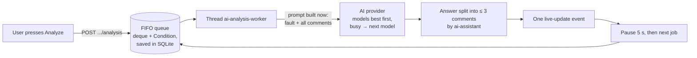

- **Exactly one thread:** it is named `ai-analysis-worker`, and `AnalysisWorker.start()` refuses to start if a live thread with that name already exists. One `AnalysisWorker` is created per process at startup (`app/api/app.py`'s lifespan) and stopped at shutdown.
- **Started on the first request:** startup creates the worker but starts **no thread and creates no provider** — it only checks the settings. The **first** Analyze request starts the thread (inside the queue lock, so two simultaneous first requests still start exactly one), and the thread's first steps are to create the provider and its HTTP client (`ProviderLoader`, `app/ai/providers/loader.py`), then Gemini model discovery. Jobs restored from SQLite start the thread at startup instead. Until then the page shows the provider and models from the settings. Once started, the thread runs until shutdown — sleeping, with no CPU use, while the queue is empty. A sleeping thread costs nothing, so it is not stopped when idle.
- **FIFO queue:** a `collections.deque` guarded by a `threading.Condition` — the worker sleeps on it while the queue is empty, and a request wakes it. A deque (not `queue.Queue`) because cancelling removes a job from the middle and the page shows each job's position. At most 50 jobs wait at once; one pending analysis per fault.
- **One request at a time, with a pause:** each call gives up after `AI_REQUEST_TIMEOUT_SECONDS` (default 180), and the analysis POST is never retried automatically (`ApiClient.post_json`), so a call can never take longer. Only the Gemini model-listing GET is retried on a timeout or connection error (3 attempts, 1 s then 2 s apart); an HTTP error or an invalid reply is never retried. After each analysis that reached the API (answer or error) the worker waits `AI_REQUEST_DELAY_SECONDS` (default 5) before the next one; jobs that never reached the API don't wait.
- **Model fallback:** each provider has an ordered list of models, best first (`app/ai/providers/base.py`). When a model is busy or out of quota — HTTP 429, 503, 500, 504 (and 529 for Claude), or 404 for a model that was retired — the next model is tried at once; the analysis fails only when the last one does, with one error comment naming each model and why. A rejected key (401/403), a bad request or a **timeout** stops at once (another model would not help, and the time is already used). The answer's header names the model that actually answered.
- **Gemini tiers:** Google offers no API that says whether a key is free or paid, so `GEMINI_TIER` says it (`app/ai/providers/gemini_models.py`). `free` (default): `gemini-3.8-flash` → `gemini-3.6-flash` → `gemini-3.5-flash-lite` → `gemini-3.1-flash-lite`. `paid`: `gemini-3.1-pro-preview` first, then the free list. `GEMINI_MODELS` replaces the list — e.g. free models only on a paid key, to save credits. The lists follow Google's model and pricing pages (October 2026).
- **Gemini model discovery (opt-in, `GEMINI_MODEL_DISCOVERY=auto`):** right after it creates the provider, before taking any job, the worker thread asks Google which models the key can use (`models.list()`, 15-second timeout) and updates the list (`gemini_models.refresh_model_list`): configured models no longer offered are **removed**; **newer** stable models are **added to the front**, newest first — `flash` and `flash-lite` on the free tier, plus `pro` only with `GEMINI_TIER=paid`. "Newer" means a higher version than the newest of that family already in the list; preview and experimental models are never added. Google's listing does not say which models are free or how good they are, and no Google API can confirm that a key has credits, so the family in the name and the tier setting decide. A list you set yourself (`GEMINI_MODELS`) is only checked, never extended. If the listing fails, the configured list is kept and the worker carries on; the server log shows what changed.
- **Persisted queue:** every queued job is a row in SQLite (`app/ai/job_store.py`, same database file); after a restart the jobs come back in order — a job that was running runs again — and go to whichever provider is configured then. Restored jobs start the worker thread right away.
- **Thread safety:** the queue is only touched while holding the condition's lock; the database stores have their own locks; live updates cross from the worker thread to the asyncio loop through the existing thread-safe `EventBroadcaster.publish()`.
- **Threads, not asyncio, in the worker:** the worker is plain `threading` — it uses no asyncio itself. Its job is one blocking HTTP call at a time, then a pause, which a thread does simply. asyncio appears only at its edge: the live-update streams run on the server's event loop, and the worker hands each event to that loop with `loop.call_soon_threadsafe` (inside `EventBroadcaster.publish()`).

**What happens to one request:**

1. The user presses **Analyze**. The comment *"tech1 requested Gemini analysis."* is added (while holding the queue lock, so it always comes before the answer), the job is saved and queued, and the button turns grey with the state: *Queued (position N)*, then *Analyzing…*. A **Cancel analysis** button appears next to it — only in that state. Other viewers of the fault get the usual "this incident changed" prompt, as for any comment.
2. When the job reaches the front: if the fault is **closed**, the job is dropped (one server log line, no comment). Otherwise the prompt is built **now** (`app/ai/prompt.py`): system instructions (how to read the data, what to write, the fixed headings *Summary, Likely cause, Evidence, Suggested next steps, Missing information, Severity assessment*, plain text, the length limit) plus — as a separate part — the fault and **all** its comments as JSON. Each comment carries its number, author, time and a type (`update`, `status_change`, `ai_analysis` for earlier analyses), and the model is told to treat everything in the JSON as data, never as instructions. A very long thread drops its oldest comments first and says how many.
3. The answer is posted by the built-in **`ai-assistant`** user (`app/ai/splitter.py`): every comment starts with *"AI analysis by Gemini (model: …)"*; a long answer is split on paragraph boundaries into at most 3 comments (*Part 1/2*, …) of at most 5,000 characters, and cut with a note if still longer. A failure (timeout, rejected key, rate limit, empty answer) posts one error comment the same way, e.g. *"AI analysis by Claude (model: …) failed: timed out after 180 seconds."* All parts are saved first, then **one** live-update event is published.
4. **Cancel** (any user): adds *"tech1 requested to cancel Gemini analysis."*. A queued job is removed at once; a running one finishes its call in the background and its answer is thrown away. Either way the buttons reset immediately.

**No repeat analyses without changes** (`app/ai/reanalysis.py`): after a **successful** analysis, the same fault cannot be analyzed again with the same provider until someone changes it — a new comment, a status change (claim, close/reopen), a new severity or assignee, or an edited title, description or details. The AI's own answers and the "requested … analysis" bookkeeping comments never count as changes. A **different provider** (e.g. Gemini then, Claude now) may analyze it again. Failed and cancelled analyses don't count. "Changed" is a hash (fingerprint) of exactly the data the model was given, stored with the provider, model and time of the last successful analysis in SQLite (table `analysis_history`), so the rule survives restarts. On the page, Analyze is greyed out with the note *No changes since the last analysis* (the reason is its tooltip). An **admin** also sees **Re-analyze**, which forces it with the same provider — but only after a cooldown since that analysis (`AI_REANALYSIS_COOLDOWN_SECONDS`, default 5 minutes), counted down live on the button (*Re-analyze in 3:12*); the comment then reads *"admin requested Gemini analysis again (forced)."* A regular user trying to force gets HTTP 403.

**Console log** (`app/ai/log.py`, level `AI_LOG_LEVEL`): every request, refusal, cancel, job start and finish, model attempt and fallback is one line on the server console, showing the thread that wrote it, and every queue change ends with the queue's state. The lines use the server's shared console format ([§11](#11-architecture--as-built), *Console log*), tagged `AI`. For example (dates trimmed):

```
INFO:     14:17:55 AI   [MainThread] AI analysis is on: Gemini (models: gemini-3.8-flash > …), timeout 180s per call - the worker starts on the first request
INFO:     14:18:05 AI   [AnyIO worker thread] Worker thread ai-analysis-worker started (first request) - Gemini (models: …), 5s pause between jobs | queue: idle, 1 waiting (seed-075)
INFO:     14:18:06 AI   [ai-analysis-worker] Created the Gemini provider and its HTTP client in 0.0s
INFO:     14:18:08 AI   [AnyIO worker thread] Queued fault seed-076 "Customer portal users randomly logged o…" for tech1 - position 1 | queue: running seed-075, 1 waiting (seed-076)
INFO:     14:18:08 AI   [AnyIO worker thread] Refused a request for fault seed-076 by tech1 - an analysis is already pending
WARNING:  14:18:10 AI   [ai-analysis-worker] gemini-3.8-flash is overloaded (503) after 2.0s - trying gemini-3.6-flash
INFO:     14:18:12 AI   [ai-analysis-worker] Finished fault seed-075: posted 1 comment (4.0s) | queue: idle, 1 waiting (seed-076)
```

**Live state of the buttons:** every queue change publishes one small `ai_analysis` event with the whole queue (`{"running": id, "queued": [ids]}`); the incident page updates its buttons from it in place — no toast, no refresh prompt.

**Trying it:** set `AI_PROVIDER=fake` in `backend/.env` (no key needed), restart, import the sample data, and open one of the complex faults `seed-075`–`seed-082`. For a real analysis with Gemini, set `GEMINI_API_KEY` (and `GEMINI_TIER=paid` if the key is billed), and restart; for Claude or OpenAI also set the model.

## 18. Future Development

We plan to implement more features in the future, such as performance improvements and users management.
- **AI analysis queue page (admin portal)** — see and manage the AI queue in the browser: what is running, what is waiting, recent results, cancel any job. Today the server console log shows the same information ([§17](#17-ai-analysis-of-faults-worker-thread)).
- **Several AI providers at once** — today exactly one provider is configured (`AI_PROVIDER`). The code is ready for more: the registry lists every provider and the worker gets its provider through a `ProviderLoader`, so supporting several means one loader per provider, each created on first use.

---

## Tech stack

- **Backend:** Python 3.9+, FastAPI, Uvicorn; packaging, dependencies and test settings in `backend/pyproject.toml`
- **Frontend:** HTML / CSS / vanilla JavaScript (no build step, no framework), served by the same app
- **Data structures:** `collections.deque` (maintenance FIFO), `heapq` (shared fault priority queue), plus `dict`, `set`, `tuple`/`NamedTuple` and `list` where each fits ([§3](#3-data-structures--what-is-used-where-and-why))
- **Encryption:** SQLCipher (`sqlcipher3`) for the whole database; `cryptography` (AES-GCM key wrapping, HKDF); `keyring` for the OS credential store (or `systemd-creds` / a protected key file)
- **Auth:** users in the encrypted database (the first admin from the setup page, regular users optionally from `.env`, fail-fast validation), admin user management, signed session cookie with a session version (Starlette `SessionMiddleware`, `itsdangerous`), two roles (Admin/User), character-mix password policy, PBKDF2 (600,000 iterations), login lockout, security headers
- **Persistence:** SQLite encrypted with SQLCipher (`app/database.py`), one connection per store guarded by a `threading.Lock`
- **Live updates:** Server-Sent Events with role-based audiences; `asyncio.Queue` per browser tab, bridged from worker threads with `loop.call_soon_threadsafe`
- **Site checks:** `httpx` (one GET per check, behind the `AvailabilityChecker` interface)
- **AI analysis (optional):** the Gemini, Claude and OpenAI REST APIs called with `requests` through our own `ApiClient` (`app/api_client.py`: timeout, `raise_for_status()`, JSON and field validation, GET retry), behind the `AnalysisProvider` interface; one named `threading.Thread` consuming a `deque` + `threading.Condition` FIFO queue persisted in SQLite
- **Configuration:** `python-dotenv` (`backend/.env`)
- **Testing:** `pytest`, `pytest-cov`, FastAPI's `TestClient`
- **CI:** GitHub Actions — the test suite on every push and pull request
- **Runs:** locally, as a single process

---

## License

Incident Bridge is released under the [MIT License](LICENSE): anyone may use, copy, change and share it, as long as the copyright notice is kept, and it comes with no warranty. The app's [Terms of Use](frontend/terms.html) page explains what this means for the people using an installation of it.
